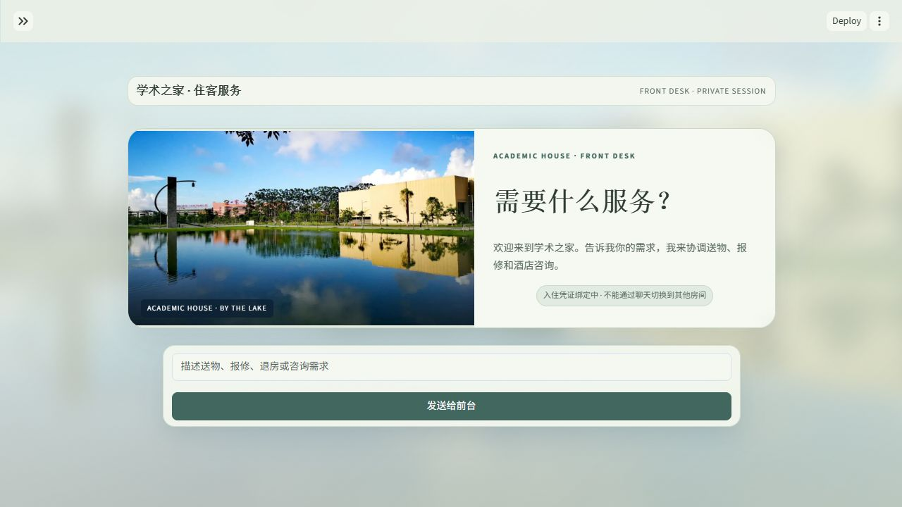
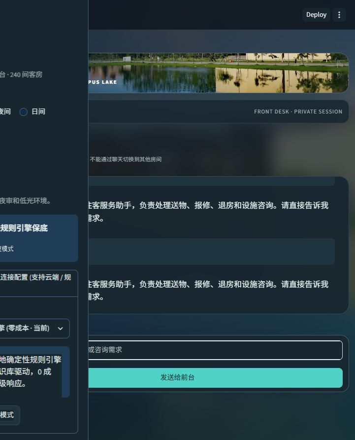
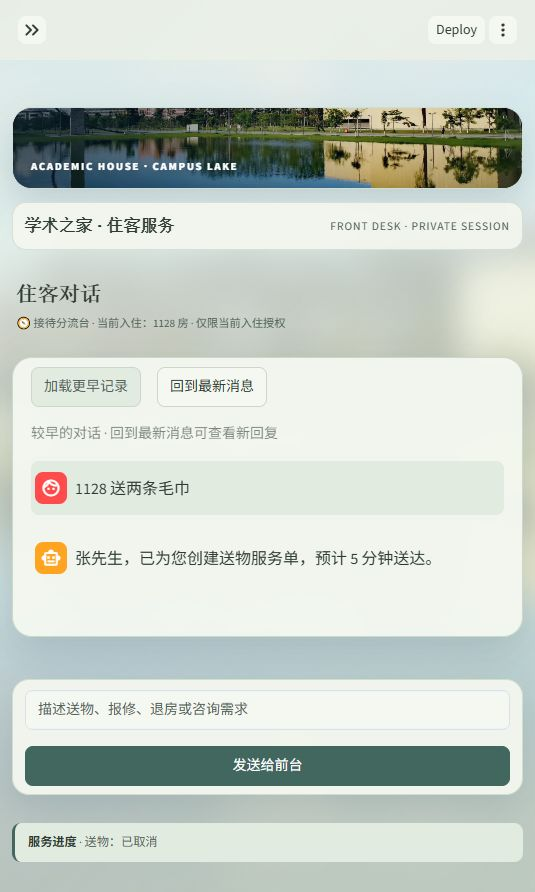

# AegisStay · 学术酒店服务运营中枢

面向学校学术酒店的访学接待与学术会议住宿，AegisStay 将住客服务请求、部门工单、房态和人工审核放在同一条可追踪业务链上。系统由接待、客房保洁、工程、礼宾和大堂经理等职责模块组成，支持多轮补充、处理中取消或改单、部门确认、库存校验和质量回归。

系统的工作是把一句自然语言需求变成可核验、可派发、可修改、可追踪的部门工单。当前版本面向单酒店小规模部署，提供 Streamlit 工作台、FastAPI 网关、SQLite 持久化、Docker Compose 运行方式和可选的 OpenAI 兼容模型接入。仓库内置 240 间客房初始数据；通过适配层替换为酒店实际 PMS 前，需要完成接口映射、权限审批和现场验收。

项目机制、业务边界与代码对应见 [项目剖析](docs/academic_hotel_analysis.md)，部署、备份和恢复见 [值班手册](docs/operations.md)。

常规客房物资使用统一的 24 项目录和实时库存；按摩、泡澡等设施按“可提供／不提供／尚未核验”配置答复，未知项目不自动派单。新增目录的默认数量为合成初值，已有酒店数据库不会因升级而自动补货。每次入住刷新上下文、WiFi 验证入口设想、多人并发、数据库与 Redis 的分工及夜审说明见 [入住数据与运营方案](docs/stay_data_and_operations.md)。

员工工单逐项展示标准物品、数量、预留库存、当前可用库存、缺口和补货建议；缺货为“待库存协调”，与可派送单分开。旧记录含未知物品或缺少有效明细时须人工核验。设施咨询按地点、开门、关门、费用等问项直接答复，多设施同问逐项保留；没有批准配置的时间与地点不补造。具体契约见 [运营工单与设施问答规格](spec/operations_ticket_and_facility.md)。

已有送物的催送会关联当前会话原单，记录提醒次数与时间，不重复下单或扣库；带明确数量的新需求仍独立核验。“水”和时效修饰分开解析，未知物品整次拒绝派送。边界见 [送物与催送规格](spec/service_reliability.md#sr-06-口语饮用水与已有订单催送)。

工作台默认进入住客端，只显示当前入住会话的对话和服务进度；员工通过侧栏工作区进入运营中枢、质量验收或难例回归。住客端不展示房态、库存、酒店仿真和内部黑板，服务权限由入住凭证绑定 `room_no`、`stay_id` 与 `session_id`，不能靠聊天切换到其他房间。界面对比度、对话动画、全楼仿真和响应式房态布局见 [界面视觉规格](spec/ui_visual_quality.md)。

住客对话以“学术之家住客服务助手”作为公开服务身份；已覆盖的内部提示、模型和权限探询在本地处理，不外呼模型或修改订单。入住授权、限定工具、提案核验和原子提交共同约束业务写入，安全边界见 [对话安全规格](spec/security_prompt_injection.md)。本地工作区选择器供开发和值班使用，不承担鉴权；公网住客入口必须使用受凭证保护的 API 工作台。

完整聊天记录与模型短上下文分别管理，住客可在固定高度的消息面板中累计加载历史，首次显示 60 条，每次向前再读至多 60 条；返回最新消息仍保留已加载记录。“全部取消”处理本会话送物，已派出或送达的物品需部门确认撤回；未知物品、混合取消/改单指令和没有业务目标的情绪表达先核验或澄清。具体行为与复测步骤见 [服务可靠性规格](spec/service_reliability.md)，本次对话、主题与真实模型复核见 [2026-10-25 验证记录](spec/conversation_followup_verification_2026-10-25.md)。

开发入口见 [AGENTS.md 仓库地图](AGENTS.md)。目标、交付清单和范围见 [主规格](spec/specification.md)，REQ-14 见 [部署与运维子规格](spec/design/deployment.md)，FIELD-01～06 见 [现场验收协议](spec/field_validation.md)，FUT-01～06 见 [未来集成规格](spec/future_integrations.md)。剩余规格的静态验收见 [补全规格验收记录](spec/remaining_spec_verification_2026-10-23.md)。详细步骤见 [实验方案](spec/experiments.md)，判定门槛见 [验收标准](spec/acceptance_criteria.md)，每条要求对应的真实测试见 [追溯矩阵](spec/traceability.md)。旧专题按 [历史规格索引](spec/legacy_specs.md) 区分适用范围。

## 产品界面

住客首屏与夜间会话来自 2026-10-25 的本地界面复核；下方业务操作截图来自受鉴权 API 工作台。数据均为合成夹具，不包含密钥或真实住客信息，采集环境和日期见 [截图说明](docs/images/README.md)。

### 住客入口与夜间对话

### 运营总览

### 工单执行明细与库存协调

缺货申请保留为待库存协调，派送和结单按钮禁用。测试范围与证据见 [工单及设施问答验收记录](spec/operations_facility_verification_2026-10-25.md)。

### 住客服务处理

### 配送变更确认

截图复现步骤和采集环境见 [产品界面截图说明](docs/images/README.md)。

## 核心流程

~~~mermaid
flowchart LR
    A[住客消息] --> B[接待理解与补槽]
    B --> C[任务关系判断]
    C --> D[后台任务与版本控制]
    D --> E[部门处理模块]
    E --> F[业务规则与库存校验]
    F --> G{当前版本仍有效？}
    G -->|是| H[写入工单与 PMS]
    G -->|否| I[丢弃过时结果]
    H --> J[运营确认与状态回执]
~~~

- **需求处理**：缺房号先补充；FAQ 与服务申请可以在同一轮保留。
- **任务控制**：每次执行有 run_id、task_id 和版本号；新需求可以取消或更新旧任务。
- **业务安全**：提交前检查房号、部门、物品、数量、风险、库存和当前业务基线。
- **执行阶段**：待派送可修改，配送中等待部门撤回确认，已送达需要确认取回；回收物品进入待检库存。
- **结果仲裁**：主控按最新需求、可信业务记录和规则决定是否提交；冲突进入人工核验。
- **模型边界**：模型可辅助提取意图、房号和情绪；工单写入、权限、库存和状态转换由程序校验。

## 运行方式

### 本地运行

使用 Python 3.12 或更高版本：

~~~powershell
python -m venv .venv
.\.venv\Scripts\python.exe -m pip install -r requirements.txt
Copy-Item .env.example .env
$env:AEGIS_FORCE_RULES='1'
.\.venv\Scripts\python.exe -m streamlit run app.py
~~~

工作台默认访问 http://localhost:8501。需要 API 时：

~~~powershell
$env:AEGIS_FORCE_RULES='1'
.\.venv\Scripts\python.exe -m uvicorn server:app --host 127.0.0.1 --port 8000
~~~

### Docker Compose

~~~powershell
.\.venv\Scripts\python.exe scripts/manage.py init
docker compose up -d --build
~~~

初始化生成已被 Git 忽略的 deploy.env，不打印密钥、不覆盖已有部署。个人岗位凭据保存在其中，应通过受控方式分发给相应员工；不要提交或公开展示该文件。

- 工作台：http://localhost:8501
- API 文档：http://localhost:8000/docs
- 就绪检查：http://localhost:8000/ready
- 持久化文件：仅 API 挂载的数据卷 /data/aegisstay.sqlite3

工作台只通过 API 办理业务，没有独立数据库和模型密钥。一个 API worker 是唯一写入者；文件写锁阻止第二个进程覆盖旧状态。端口默认仅绑定本机，酒店网络访问应经过 HTTPS 反向代理。当前机器未安装 Docker，容器构建未在本机实跑；CI 已增加 Linux 测试与镜像构建步骤，结果需以实际运行记录为准。

## 配置与权限

本地离线开发使用 .env.example；部署使用生成的 deploy.env。生产强制启用鉴权、持久化和随机强密钥，缺少配置时启动失败。

| 变量 | 作用 |
| --- | --- |
| AEGIS_DB_PATH | API 的 SQLite 文件路径 |
| AEGIS_API_URL | 工作台连接的固定 API 地址；工作台不打开数据库 |
| AEGIS_DEPLOYED | 部署模式，禁止无鉴权、无持久化运行 |
| AEGIS_STAFF_TOKEN | 初始化管理员凭据，不能分发给住客 |
| AEGIS_STAFF_KEYS_JSON | 每位员工的 subject 与岗位凭据映射 |
| AEGIS_SIGNING_KEY | 住客凭证签名密钥，不能与员工凭据共用 |
| AEGIS_SITE_PROFILE | academic 为学术接待政策；standard 为原固定回归基线 |
| AEGIS_BUSINESS_DATE | 新库初始业务日期；已有数据库按持久化日期恢复，不随重启推进 |
| AEGIS_PMS_FILE / AEGIS_KNOWLEDGE_FILE | 经核验的初始房态与批准的政策文件 |
| AEGIS_ALLOWED_ORIGINS | API 允许的前端来源 |
| AEGIS_FORCE_RULES | 1 使用规则；关闭后才允许模型调用 |
| OPENAI_BASE_URL / OPENAI_MODEL / OPENAI_API_KEY | 仅 API 服务持有的模型配置 |

住客没有全店共享 Token。前台核验订单和入住身份后签发有有效期的访问凭证，绑定 room_no、stay_id、session_id；吊销、到期、换客后失效。员工按前台、客房、工程、经理和管理员岗位授权，部门岗位不能读取住客聊天档案。资源归属与权限在 API 检查，不能依赖页面隐藏按钮。

学术酒店的延退由前台核对接待订单和排期；系统不会根据自述学者／嘉宾身份自动赠送权益。初始政策模板没有真实学校会场、早餐时间和校园通行规则，须经酒店审核补齐。

## API 入口

| 方法 | 路径 | 权限 | 用途 |
| --- | --- | --- | --- |
| POST | /api/chat | 住客 | 同步处理一条消息 |
| POST | /api/chat/submit | 住客 | 提交后台任务，返回执行标识 |
| GET | /api/tasks/{run_id} | 住客 | 查询本会话任务 |
| GET | /api/session/{session_id} | 住客 | 查询会话与服务进度 |
| POST | /api/session/reset | 住客 | 清理本会话 |
| GET | /api/pms/overview | 员工 | 查看房态与部门队列 |
| GET | /api/tickets | 员工 | 查询工单 |
| POST | /api/tickets/{ticket_id}/dispatch | 员工 | 确认开始配送 |
| POST | /api/tickets/{ticket_id}/change/confirm | 员工 | 确认或拒绝配送变更 |
| POST | /api/tickets/{ticket_id}/complete | 员工 | 完成工单 |
| POST | /api/pms/night-audit | 员工 | 执行跨日夜审 |
| POST | /api/guest-access | 前台／经理 | 核验后签发本次入住凭证 |
| POST | /api/guest-access/{id}/revoke | 前台／经理 | 吊销访问凭证 |
| POST | /api/rooms/{room_no}/stay | 前台／经理 | 登记接待台账，更替入住并吊销旧凭证 |
| POST | /api/checkout/{room_no}/review | 前台／经理 | 审批延退 |
| GET | /api/session/{session_id}/messages | 本会话住客 | 分页查询历史消息 |
| GET | /api/audit | 经理／管理员 | 查看员工操作审计 |

## 持久化与恢复

设置 AEGIS_DB_PATH 后，SQLite 在同一事务保存共享房态、工单、库存、延退记录、会话、请求幂等记录、消息和审计。只有写入成功才返回业务成功；写库失败会回滚内存修改。服务重启时会恢复已提交业务状态；正在运行的后台任务会标记为 interrupted，需要重新提交，避免恢复一个已经失去外部回执的动作。

会话消息按滑动窗口裁剪，早期消息独立归档，住客持有效凭证可跨天恢复同一会话并分页查看。工作黑板保存房号、待办、任务版本和冲突。数据库保存的是应用状态，不等于完整 CRM 客史；多酒店租户隔离、数据保留策略和删除请求需要根据酒店要求另行配置。定期备份 /data/aegisstay.sqlite3，并限制文件权限。

## 模型与质量控制

没有模型密钥或调用失败时，系统使用本地规则继续提供确定性业务处理。动态 Few-Shot 只改变本次模型输入，不会更新模型参数。当前质量底座保留 20 条 H01–H20 固定兼容回归，并增加 5 组、40 条 E01–E40 分层质量集；页面可以分别查看基线或运行 60 条分层报告，显示分组指标、Wilson 95% 区间和 P95 耗时。它不把评测通过率当成真实模型泛化率，也不把示例更新称为微调。详细门槛见 [分层质量验收子规格](spec/quality_evaluation.md)。

连接硅基流动时，在侧栏选择对应服务商，填写 `https://api.siliconflow.cn/v1`、准确的模型 ID 和 API Key，点击“保存并连接云端大模型”。工作台会先执行只读 `/v1/models` 预检，确认选定模型存在后才显示云端在线；`AEGIS_FORCE_RULES=1` 只在明确点击云端连接时解除。当前虚拟环境没有 `openai` SDK 时，若已安装 `httpx` 会自动使用兼容 HTTP 传输；两者都不可用或探测失败会显示错误码，不会伪装成连接成功。部署验收还要求连续 3 次 HTTP 200、模型命中、每次不超过 12 秒、成功率 100%，详见 [MODEL-CONN-01](spec/design/deployment.md#33-硅基流动openai-兼容连接预检)。

固定回归与业务边界测试：

统一证据入口会强制使用离线环境，在新建目录保存原始日志、退出码、源码指纹、结构化指标和黑板断言。失败、缺失证据或跳过用例均不能报告通过；产物默认保存在被 Git 忽略的 `.artifacts/`。GitHub CI 执行同一入口并归档证据。

本机运行的来源、实测结果与适用边界见 [服务可靠性验收记录](spec/service_reliability_verification_2026-10-25.md)；早期基线保留在 [规格体系验收记录](spec/specification_verification_2026-10-23.md)。

本轮湖景入口、24 项物资、8 位住客库存竞争及 17 轮实际模型联调的结果见 [酒店服务完善验收记录](spec/hotel_readiness_verification_2026-10-25.md)。

最新口语送物/催送与帮助提示修复：完整 397 项、核心 43 项、原始 127 项及固定 Harness 全通过；12 轮硅基流动合成联调和三主题浏览器证据见 [送物催送验收记录](spec/delivery_followup_verification_2026-10-25.md)。这些是指定运行的代码与联调证据，现场验收仍待执行。

~~~powershell
.\.venv\Scripts\python.exe -B -X utf8 scripts/verify_release.py --output-dir .artifacts/verification/local-001
~~~

需要单独定位时可执行以下命令；正式验收仍以统一入口的完整证据为准：

~~~powershell
$env:AEGIS_FORCE_RULES='1'
$env:AEGIS_AUTH_ENABLED='0'
$env:AEGIS_DEPLOYED='0'
$env:AEGIS_DB_PATH=''
$env:AEGIS_SITE_PROFILE='standard'
Remove-Item Env:AEGIS_API_URL -ErrorAction SilentlyContinue
.\.venv\Scripts\python.exe -B -X utf8 -m unittest discover -s tests -p 'test_*.py'
.\.venv\Scripts\python.exe -B -X utf8 -m unittest tests/test_app.py
.\.venv\Scripts\python.exe -B -X utf8 -m harness.eval_runner
.\.venv\Scripts\python.exe -B -X utf8 -m harness.eval_runner --extended
~~~

当前版本新增了入住凭证、岗位隔离、同库多写入防护、写入失败回滚、重启幂等和 API 工作台等验收。完整结果见 [2026-10-23 验收记录](spec/release_verification_2026-10-23.md)。原版记录保留为历史证据。这是离线规则和本地状态验证，不是生产容量或真实 PMS 回执证明。

## 目录

~~~text
app.py                 Streamlit 工作台
deployed_ui.py         按身份和岗位显示的 API 工作台
api_client.py          工作台 HTTP 访问层
server.py              FastAPI 网关与权限入口
hotel_core.py          黑板状态、部门处理和业务规则
agent_runtime.py       后台任务、版本、幂等、SQLite 状态边界
persistence.py         SQLite 状态存储
auth.py                岗位凭据、入住签名凭证与资源归属
data/                  初始房态与酒店知识
harness/               回归数据、难例和示例检索
tests/                 业务、API、并发、界面和持久化测试
spec/                  接口契约、验收记录和后续设计
scripts/manage.py      部署初始化与一致性备份
Dockerfile             非 root 服务镜像
docker-compose.yml     单酒店部署编排
~~~

## 酒店现场对接

1. 接入酒店 PMS、库存和工单系统，使用幂等命令和外部回执替换本地写入。
2. 对接学校统一身份认证，确认个人岗位、数据保留策略与凭据分发。
3. 配置备份、恢复演练和监控；需要多实例部署时再迁移数据库并设计多副本一致性。
4. 建立真实 bad case 审核、独立测试集、发布审批和回滚流程。
5. 在酒店现场用脱敏数据验证取消、撤回、延退、客诉升级和夜审规则。
