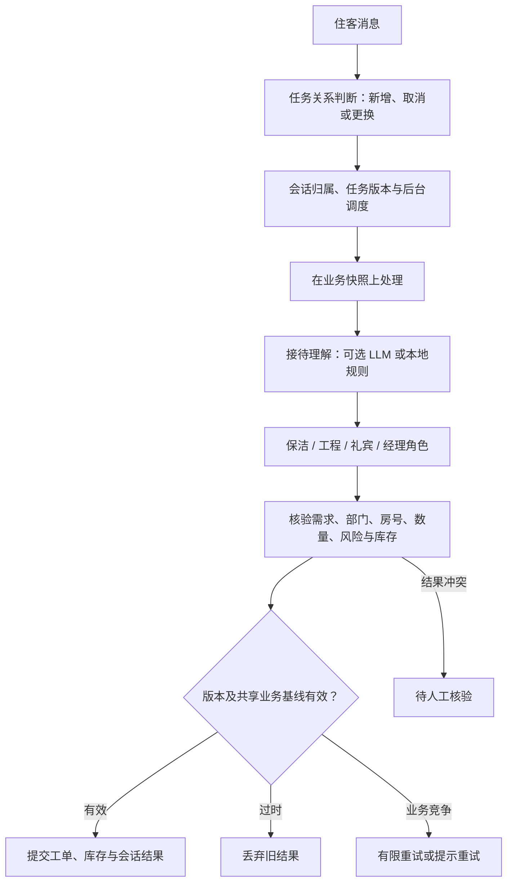

# AegisStay · 智慧酒店 Multi-Agent 协同 Demo

用 Python 实现接待、保洁、工程、礼宾和经理的角色协同，将住客需求连接到可校验的工单与模拟 PMS。提供 Streamlit 界面、FastAPI 接口、后台任务控制和离线回归评测。

**2026-10-20 版本**：支持处理期间继续输入、取消／改单、旧任务结果失效、部门回执确认和结果冲突核验；补充“水不用了”等口语取消。全部业务数据为本地模拟，状态保存在单进程内存中。

## 运行截图

以下为本版实际页面，使用离线规则和模拟住客数据。截图不是设计稿；复现过程见 [截图说明](docs/images/README.md)。

### 酒店运营与房态

模拟 240 间客房，查看房态、部门待办、工单、延退审批、库存及跨日夜审。


### 多张工单中的口语取消

先申请毛巾和矿泉水；说“不用了”时追问对象，说“水不用了”时只取消矿泉水，保留毛巾工单。本例由物品别名、取消规则和当前工单状态共同完成。


### 派送中更换，需要部门确认

毛巾已开始配送，再改为两条浴巾。系统先记录变更，由运营端确认能否撤回；确认前不向住客承诺已经更换成功。


### 离线 Harness 报告

页面运行 20 条固定场景，逐项显示意图、槽位、派单和任务结果。这些指标仅针对已知离线用例，不代表真实模型泛化能力。


## 本版实现

| 能力 | 当前行为 |
| --- | --- |
| 多轮服务 | 缺房号先追问，保留待办；FAQ 与服务申请可在同一轮处理 |
| 角色协同 | 接待理解需求，编排器路由部门，校验结构化结果后提交 |
| 后台任务 | 有界线程池；不同会话可并发，同会话按任务关系更新或排队 |
| 取消与改单 | `task_id`、`run_id` 和递增版本；提交前阻止过时结果建单、扣库存或发送成功回复 |
| 库存一致性 | 在业务快照上计算，短临界区核验版本及共享业务基线后提交；冲突有限重试 |
| 已执行动作 | 待派送可直接变更；配送中等待撤回回执；已送达需确认取回 |
| 主子结果不一致 | 按最新需求、可信业务状态和规则校验；冲突记录为待核验，不落单、不扣库存 |
| 重复请求 | 同会话 `request_id` 复用原执行；内存记录保留期间有效 |
| PMS 与权限规则 | 模拟会员权益、延退人工审批、跨房操作检查、风险提级与夜审 |
| 评测与示例 | 20 条固定回归、4 条预置难例、最多两条相关 Few-Shot 示例 |

## 模型、规则与执行控制怎样分工



接待层可调用兼容接口提取意图、房号和情绪；无 Key、调用失败或设置 `AEGIS_FORCE_RULES=1` 时使用规则。当前取消／更换动作及目标工单定位由程序规则和状态完成，模型没有接收完整历史与当前工单来做该项解析。部门角色主要是 Python 业务类，尚无各自独立的自主规划循环。

取消是协作式的：已经发出的模型请求可能仍会执行，但过时结果不能提交。设置取消标记不等于立即停止推理或节省相应 token。

## 黑板、记忆与 Few-Shot

| 数据 | 存在哪里 | 当前边界 |
| --- | --- | --- |
| 会话消息、房号与待办 | `HotelState`，按 `session_id` 管理 | 内存隔离；session ID 不是生产身份认证 |
| 任务版本、执行记录与冲突 | `SessionManager` 和会话黑板 | 用于任务衔接与提交控制，重启不恢复 |
| 消息窗口与摘要 | Python 列表和截断文本 | 超过 12 条消息保留 6 条；截断摘要尚未注入模型理解调用 |
| 房态、工单、库存 | 同一运行时内共享的模拟业务状态 | 单进程有效；Streamlit 与单独启动的 FastAPI 不共享内存 |
| 业务知识与示例 | 仓库内 JSON 文件 | FAQ 为关键词／模糊匹配；Few-Shot 按字符相似度选最多两条 |

Few-Shot 更新改变的是本次模型输入，没有修改模型参数。`self_evolution.py` 当前加载预置难例和诊断、执行回归并读取示例库；尚未接通线上 bad case 自动采集、自动提炼、候选审核发布和独立前后对照。既有 `evolution_delta` 是固定演示字段，不能作为提升证据。相关 [演进规范](spec/self_evolving_harness_and_memory_spec.md) 包含未来设计目标。

## 快速运行

建议使用独立虚拟环境。前端的 fragment 刷新需要 Streamlit >= 1.57。

```powershell
python -m venv .venv
.\.venv\Scripts\python.exe -m pip install -r requirements.txt
$env:AEGIS_FORCE_RULES='1'
.\.venv\Scripts\python.exe -m streamlit run app.py
```

默认访问 `http://localhost:8501`。页面提供住客、运营、Harness 和“难例回归与 Few-Shot”四个视角。

如需尝试模型，复制 `.env.example` 为 `.env`，配置兼容接口、模型和 Key，移除强制规则环境变量后重启。也可使用侧边栏配置。`.env`、`config.json` 和本地虚拟环境均被 Git 忽略，请勿将真实密钥提交仓库。

```powershell
Copy-Item .env.example .env
Remove-Item Env:AEGIS_FORCE_RULES -ErrorAction SilentlyContinue
.\.venv\Scripts\python.exe -m streamlit run app.py
```

独立启动 API：

```powershell
$env:AEGIS_FORCE_RULES='1'
.\.venv\Scripts\python.exe -m uvicorn server:app --host 127.0.0.1 --port 8000
```

交互文档：`http://127.0.0.1:8000/docs`。

| 接口 | 用途 |
| --- | --- |
| `POST /api/chat` | 同步兼容入口 |
| `POST /api/chat/submit` | 提交后台任务，返回 202 与执行标识 |
| `GET /api/tasks/{run_id}?session_id=...` | 查询归属于该会话的执行记录 |
| `GET /api/session/{session_id}` | 查看会话状态与任务 |
| `POST /api/tickets/{ticket_id}/dispatch` | 确认开始配送 |
| `POST /api/tickets/{ticket_id}/change/confirm` | 同意／拒绝撤回或更换 |

此 API 用于本地演示，生产鉴权、租户隔离、持久化、分布式事务和真实 PMS 对接尚需实现。

## 试一遍取消和改单

在住客端依次发送：

```text
1128 给我送两条毛巾
再送两瓶矿泉水
不用了
水不用了
```

预期先追问取消对象，再只取消矿泉水；毛巾仍在处理中。随后在运营页搜索 `1128`，点击毛巾工单的“确认开始派送”，再在住客端输入：

```text
不要毛巾了，改成浴巾
```

预期保留“两条”的数量，等待部门确认。运营端同意或拒绝变更后，住客端收到对应通知。要稳定复现“旧任务晚返回”的竞争条件，请运行自动化竞争测试；本地规则执行很快，连续手工输入未必赶在旧任务提交之前。

更多场景见 [手动测试范例](spec/manual_testing_examples.md)、[取消和仲裁说明](spec/task_interruption_and_arbitration.md)、[口语取消修复](spec/colloquial_delivery_cancellation.md)。

## 验证结果

2026-10-20，在强制离线规则模式下：**96 项单元／集成测试通过，20/20 条 Harness 场景通过**。测试覆盖业务规则、API 会话归属、幂等、库存竞争、晚到结果、部门变更确认、口语取消及 3 项 Streamlit 交互测试。

```powershell
$env:AEGIS_FORCE_RULES='1'
.\.venv\Scripts\python.exe -B -X utf8 -m unittest discover -s tests -p 'test_*.py'
.\.venv\Scripts\python.exe -B -X utf8 -m unittest tests/test_app.py
.\.venv\Scripts\python.exe -B -X utf8 -m harness.eval_runner
```

完整摘要、20 条报告及业务状态／Trace 断言见 [本版验收记录](spec/release_verification_2026-10-20.md)。本版未做付费模型评测、生产压测或单／多 Agent token 对照。

## 代码与文档入口

```text
app.py                 Streamlit 四个工作视角
server.py              FastAPI 接口
hotel_core.py          黑板、部门角色与业务规则
agent_runtime.py       后台执行、版本、幂等和快照提交
agent_protocol.py      送物解析与部门结果契约
data/                  模拟 PMS、FAQ
harness/               固定评测、预置难例和示例检索
tests/                 96 项离线测试
docs/images/           实际运行截图及复现说明
docs/interview.md      项目介绍与面试追问逐字稿
spec/                  实现说明、测试范例、验收与后续设计
```

面试练习见 [酒店项目逐字稿](docs/interview.md)，按“问题、职责、机制、证据、边界”说明当前实现。
