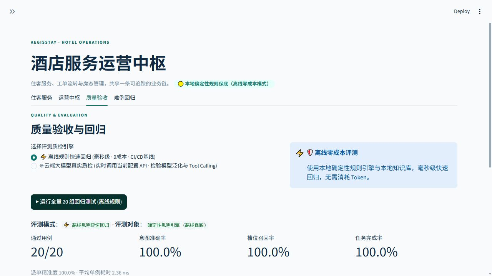

# AegisStay · 酒店服务运营中枢

AegisStay 将住客服务请求、部门工单、房态和人工审核放在同一条可追踪业务链上。系统由接待、客房保洁、工程、礼宾和大堂经理等职责模块组成，支持多轮补充、处理中取消或改单、部门确认、库存校验和质量回归。

当前版本面向单酒店小规模部署，提供 Streamlit 工作台、FastAPI 网关、SQLite 持久化、Docker Compose 运行方式和可选的 OpenAI 兼容模型接入。仓库内置 240 间客房初始数据；通过适配层替换为酒店实际 PMS 前，需要完成接口映射、权限审批和现场验收。

## 产品界面

截图来自当前版本页面，统一使用浅色主题和 1280 × 720 浏览器视口。数据为仓库内置的初始酒店数据，图片展示完整业务上下文，不包含密钥或真实住客信息。

### 运营总览

### 住客服务处理

### 配送变更确认

### 质量回归

截图复现步骤和采集环境见 [产品界面截图说明](docs/images/README.md)。

## 核心流程

~~~mermaid
flowchart LR
    A[住客消息] --> B[接待理解与补槽]
    B --> C[任务关系判断]
    C --> D[后台任务与版本控制]
    D --> E[部门处理模块]
    E --> F[业务规则与库存校验]
    F --> G{当前版本仍有效？}
    G -->|是| H[写入工单与 PMS]
    G -->|否| I[丢弃过时结果]
    H --> J[运营确认与状态回执]
~~~

- **需求处理**：缺房号先补充；FAQ 与服务申请可以在同一轮保留。
- **任务控制**：每次执行有 run_id、task_id 和版本号；新需求可以取消或更新旧任务。
- **业务安全**：提交前检查房号、部门、物品、数量、风险、库存和当前业务基线。
- **执行阶段**：待派送可修改，配送中等待部门撤回确认，已送达需要确认取回。
- **结果仲裁**：主控按最新需求、可信业务记录和规则决定是否提交；冲突进入人工核验。
- **模型边界**：模型可辅助提取意图、房号和情绪；工单写入、权限、库存和状态转换由程序校验。

## 运行方式

### 本地运行

使用 Python 3.12 或更高版本：

~~~powershell
python -m venv .venv
.\.venv\Scripts\python.exe -m pip install -r requirements.txt
Copy-Item .env.example .env
$env:AEGIS_FORCE_RULES='1'
.\.venv\Scripts\python.exe -m streamlit run app.py
~~~

工作台默认访问 http://localhost:8501。需要 API 时：

~~~powershell
$env:AEGIS_FORCE_RULES='1'
.\.venv\Scripts\python.exe -m uvicorn server:app --host 127.0.0.1 --port 8000
~~~

### Docker Compose

~~~powershell
Copy-Item .env.example .env
# 部署前编辑 .env：设置 AEGIS_AUTH_ENABLED=1，并替换两个令牌
docker compose up -d --build
~~~

- 工作台：http://localhost:8501
- API 文档：http://localhost:8000/docs
- 健康检查：http://localhost:8000/health
- 持久化文件：Docker volume 中的 /data/aegisstay.sqlite3

Compose 使用一个 API worker 和一个工作台进程，适合单酒店小规模部署。扩展到多 worker 或多副本时，应将业务状态迁移到 PostgreSQL/Redis，并增加跨进程锁、备份和故障转移，不要直接把 SQLite 文件挂到多个写入副本。

## 配置与权限

复制 .env.example，生产环境通过部署平台的 Secret 注入敏感值：

| 变量 | 作用 |
| --- | --- |
| AEGIS_DB_PATH | SQLite 文件路径；容器中建议 /data/aegisstay.sqlite3 |
| AEGIS_AUTH_ENABLED | 设为 1 后启用 Bearer 令牌校验 |
| AEGIS_GUEST_TOKEN | 住客接口令牌 |
| AEGIS_STAFF_TOKEN | 员工接口令牌，可访问工单、房态和审核接口 |
| AEGIS_ALLOWED_ORIGINS | CORS 允许来源，生产环境填写工作台域名 |
| AEGIS_FORCE_RULES | 设为 1 使用确定性规则；生产可关闭并配置模型 |
| OPENAI_BASE_URL | OpenAI 兼容服务地址 |
| OPENAI_MODEL | 模型名称 |
| OPENAI_API_KEY | 模型密钥，不提交到 Git |

启用鉴权后，请求带上：

~~~http
Authorization: Bearer <guest-or-staff-token>
~~~

健康检查保持公开；运营接口要求员工令牌，住客接口要求住客或员工令牌。生产环境还应在反向代理层启用 HTTPS、限流、审计日志和统一身份认证。

## API 入口

| 方法 | 路径 | 权限 | 用途 |
| --- | --- | --- | --- |
| POST | /api/chat | 住客 | 同步处理一条消息 |
| POST | /api/chat/submit | 住客 | 提交后台任务，返回执行标识 |
| GET | /api/tasks/{run_id} | 住客 | 查询本会话任务 |
| GET | /api/session/{session_id} | 住客 | 查询会话与服务进度 |
| POST | /api/session/reset | 住客 | 清理本会话 |
| GET | /api/pms/overview | 员工 | 查看房态与部门队列 |
| GET | /api/tickets | 员工 | 查询工单 |
| POST | /api/tickets/{ticket_id}/dispatch | 员工 | 确认开始配送 |
| POST | /api/tickets/{ticket_id}/change/confirm | 员工 | 确认或拒绝配送变更 |
| POST | /api/tickets/{ticket_id}/complete | 员工 | 完成工单 |
| POST | /api/pms/night-audit | 员工 | 执行跨日夜审 |
| POST | /api/admin/reset | 员工 | 重置全店初始状态 |

## 持久化与恢复

设置 AEGIS_DB_PATH 后，SQLite 保存共享房态、工单、库存、延退记录和会话上下文。服务重启时会恢复已提交业务状态；正在运行的后台任务会标记为 interrupted，需要重新提交，避免恢复一个已经失去外部回执的动作。

会话消息按滑动窗口裁剪，工作黑板保存房号、待办、任务版本和冲突。数据库保存的是应用状态，不等于完整 CRM 客史；跨天客史、租户隔离、数据保留策略和删除请求需要根据酒店合规要求另行配置。生产部署请定期备份 /data/aegisstay.sqlite3，并限制文件权限。

## 模型与质量控制

没有模型密钥或调用失败时，系统使用本地规则继续提供确定性业务处理。动态 Few-Shot 只改变本次模型输入，不会更新模型参数。当前质量底座包括 20 条固定回归、预置难例和运行时示例检索；它不把评测通过率当成真实模型泛化率，也不把示例更新称为微调。

固定回归与业务边界测试：

~~~powershell
$env:AEGIS_FORCE_RULES='1'
.\.venv\Scripts\python.exe -B -X utf8 -m unittest discover -s tests -p 'test_*.py'
.\.venv\Scripts\python.exe -B -X utf8 -m unittest tests/test_app.py
.\.venv\Scripts\python.exe -B -X utf8 -m harness.eval_runner
~~~

当前验收记录为 98 项测试通过、Harness 20/20；完整输出和 Trace 断言见 [发布验收记录](spec/release_verification_2026-10-20.md)。这是离线规则和本地状态验证，不是生产容量或真实 PMS 回执证明。

## 目录

~~~text
app.py                 Streamlit 工作台
server.py              FastAPI 网关与权限入口
hotel_core.py          黑板状态、部门处理和业务规则
agent_runtime.py       后台任务、版本、幂等、SQLite 状态边界
persistence.py         SQLite 状态存储
auth.py                Bearer 令牌权限边界
data/                  初始房态与酒店知识
harness/               回归数据、难例和示例检索
tests/                 业务、API、并发、界面和持久化测试
spec/                  接口契约、验收记录和后续设计
Dockerfile             API 容器镜像
docker-compose.yml     单酒店部署编排
~~~

## 生产化路线

1. 接入酒店 PMS、库存和工单系统，使用幂等命令和外部回执替换本地写入。
2. 将令牌替换为酒店统一身份认证，补充员工角色、租户、审计和数据保留策略。
3. 用 PostgreSQL/Redis 替换 SQLite，配置备份、迁移、监控和多副本一致性。
4. 建立真实 bad case 审核、独立测试集、发布审批和回滚流程。
5. 在酒店现场用脱敏数据验证取消、撤回、延退、客诉升级和夜审规则。
