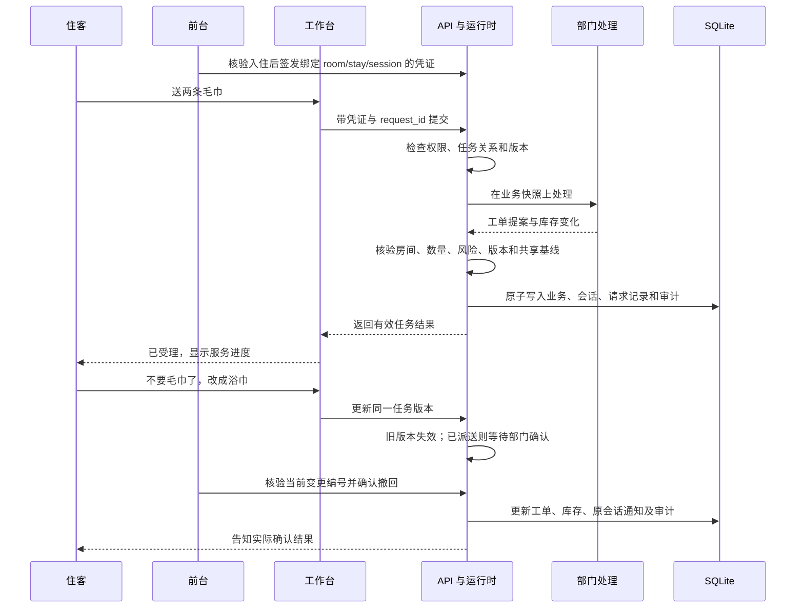

# 学术酒店项目剖析：从一句需求到部门办理闭环

业务背景按学校学术酒店设定：学校接待来访教师、访问学者和学术会议参会人员，酒店前台、客房、工程与值班经理共同提供住宿服务。该背景用于业务设计，不代表仓库已经连接某所学校的真实 PMS，也不包含未经核实的上线日期、使用人数或降本数据。

## 这个项目到底在做什么

**它把住客说的一句话，变成能核验、能派发、能修改、能追踪的酒店服务流程。**

例如住客说“送两条毛巾”，系统确认本次入住，把物品、数量、房间整理成工单，检查库存，交给客房部门。住客改口“不要毛巾了，要浴巾”时，系统还要判断原任务是否提交、是否已经配送、能否撤回，再把处理结果反馈给住客。聊天只是入口，核心是服务请求的执行控制和部门协同。

它承担服务受理与协调，收费结算、公安入住登记、学校身份认证、真实发票和外部 PMS 回执仍由相应系统或工作人员负责。

## 为什么是学术酒店

| 业务特点 | 会出现的问题 | 本项目的处理 |
| --- | --- | --- |
| 会议和访学集中到店 | 前台同时受理很多重复问询 | 查询经过确认的酒店／会务知识，未知安排转前台 |
| 住客来自不同接待单位 | 自述“我是会议嘉宾”被误当成免费权益 | 权益以接待订单和前台审批为准，学术模式不自动套用商业会员延退 |
| 教师会议结束较晚 | 延退与次日入住、保洁排期冲突 | 登记延退申请，前台按实际排期审批 |
| 客房与工程各有职责 | 送物、维修、客诉来回转交 | 按部门路由，紧急事项提级，保留可核验的工单 |
| 住客会取消或改需求 | 旧任务晚返回，重复派送或多扣库存 | 版本校验、请求幂等、派送后部门确认 |
| 房间循环使用 | 上一位住客仍能查看房间服务 | 访问凭证绑定本次入住，换客更换 stay_id 并吊销旧凭证 |

`data/academic_hotel_knowledge.json` 是待酒店审核的初始知识模板。会议地点、校园通行规则、早餐时间和财务待遇不能靠模型猜；酒店确认后，可用批准的 JSON 文件替换模板。

## 谁在系统里做什么

| 使用者／模块 | 负责的事情 | 不应获得的权限 |
| --- | --- | --- |
| 住客 | 咨询、送物、报修、修改本次服务、看自己的记录 | 查看其他房间、签发凭证、审批延退、操作全店库存 |
| 前台 | 核验入住、签发／吊销访问凭证、登记接待台账、审批延退 | 直接把模型建议当成真实 PMS 回执 |
| 客房人员 | 查看和办理客房工单、确认派送与撤回 | 完成工程工单、读取无关住客档案、签发访问凭证 |
| 工程人员 | 查看和处理工程维修 | 修改客房配送和其他部门业务 |
| 经理／管理员 | 处理风险、核验冲突、查看审计与管理部署 | 跳过业务检查直接执行任意模型输出 |
| 接待理解模块 | 提取意图、房号、情绪，衔接补充信息 | 决定住客身份、任意房间权限和费用减免 |
| 主控运行时 | 分任务、处理版本、核验提案、统一提交 | 以“主 Agent 身份”替代事实和规则 |

部署使用每位员工自己的岗位凭据。管理员启动凭据只用于初始化管理，不应多人共享当作日常工号。

## 一条真实可运行的业务链

“后台计算结束”和“毛巾已经送到”是两种状态。计算结束可以生成一张待派送工单；只有部门确认后才进入配送中／已完成。不能把模型输出“办理好了”当成服务完成。

## LLM、Agent、黑板各自是什么

**LLM 是语言理解部件。** 可选模型用于提取意图、房号和情绪；没有 Key 或调用失败时可走规则。当前取消对象定位仍使用别名、规则与工单状态，例如“水不用了”定位到矿泉水。当前版本没有验证任意口语表达都能理解。

**Agent 在这里体现职责分工。** 保洁、工程、礼宾和经理处理不同业务。大部分部门类是确定性 Python 处理器，不是每个部门都跑一个独立的大模型规划循环。系统实现的是受约束的角色协同；后续若让某角色自主调用工具，还要增加预算、停止条件和独立验收。

**黑板是结构化业务状态。** 包含绑定房间、待办、任务版本、工单、审批和冲突。它让下一个处理步骤知道已经做了什么，也让程序能检查旧结果还能不能提交。黑板可以由单 Agent 使用；是否拆角色取决于职责和维护边界，不能靠“共享记忆”证明一定需要多 Agent。

**本项目的酒店知识查询还不是语义向量 RAG。** 当前是经过审核的 JSON 政策加关键词／字符匹配。若未来接入长篇校内接待规程，可扩展成带文档版本、来源和证据引用的 RAG，但不能把该设计说成已经完成。

## 记忆到底怎样保存

| 信息 | 运行时 | 持久化与读取 | 模型是否自动看到 |
| --- | --- | --- | --- |
| 最近对话 | `HotelState.messages` | SQLite 会话窗口 | 不是；需显式组织模型输入 |
| 更早消息 | 数据库消息归档 | 按 session 分页查询，窗口裁剪不删除归档 | 不是 |
| 当前房号、待办、版本 | 黑板结构化字段 | 与业务在同一事务保存，重启恢复 | 程序主要直接读取 |
| 住客身份与本次入住 | 受控凭证、PMS 台账与 stay_id | 前台核验、凭证签发／吊销 | 不能交给模型自行认定 |
| 工单、房态、可用库存 | 全店共享状态 | API 单写入 SQLite | 按业务需要提供，不能全量泄露给住客 |
| 截断摘要 | `rolling_summary` | 保存在会话字段 | 当前没有注入理解调用，不当成模型记忆优化证据 |

用户隔天回来，持有仍有效的本次入住凭证，可以恢复该会话和查询历史。过期或换客后需要前台重新核验。日期用于查询或归档，不承担身份隔离；session_id 也不是密码。

## 这次具体修了哪些落地问题

| 风险 | 修复机制 | 验证方法 |
| --- | --- | --- |
| 多个工作台和 API 各写自己的内存快照 | 部署工作台只调用 API；SQLite 独占写入锁阻止第二个业务进程 | 两个写入运行时竞争同库时，第二个明确失败 |
| 工单落库但会话没保存 | 业务、会话、请求幂等记录、消息与审计在一个事务提交 | 注入会话写入失败，核对业务未部分提交 |
| 磁盘失败仍返回“成功建单” | 回滚内存修改，事务成功后才完成 Future | 注入写库失败，工单为零、库存不变、返回失败 |
| 重启后网络重试再次建单 | 恢复持久化 request_id 与原执行结果 | 重启并重试同一 ID，只保留原工单和一次扣库存 |
| 共享住客 Token 可以猜其他 session_id | 每次入住签发有时限的房间／入住／会话凭证 | 跨房、跨会话、吊销、过期与换客用例 |
| 新住客能改到同房间其他会话的旧工单 | 目标定位、工作快照和提交层都检查本次入住与会话归属 | 新凭证发送“毛巾不用了”，原会话工单与库存保持不变 |
| 旧住客任务还在运行 | 提交前再次检查 stay_id、凭证有效性与任务版本 | 阻塞任务后吊销凭证，再释放，确认不能建单 |
| 员工确认了过时的改单 | 变更有 change_id，操作必须匹配当前编号 | 连续改两次后拿旧编号确认，返回冲突 |
| 部门凭据被用来读取住客私聊 | 聊天档案接口限制到本住客及前台／经理，部门房态字段最小化 | 工程凭据查询住客消息返回 403 |
| 换客后延退审批命中旧申请 | 申请有独立编号，关联入住与原会话，审批携带当前编号 | 拒绝旧入住申请，当前住客同时间申请可以审批 |
| 延退审批被解释为免费 | 学术模式仅通知时间获批，费用以接待订单与前台确认为准 | 检查通知不自动承诺免房费 |
| 已回收毛巾直接算干净库存 | 已送达物品回收进入待检库存 | 验证可用毛巾数量不回增、待检数量增加 |
| 多次点击夜审连续跨日 | 提交 expected_date，日期已改变就拒绝重复操作 | 同一日期连续点击，只允许第一次推进 |
| 旧消息裁剪后无法查询 | 独立消息归档与分页 | 多轮对话后重启，仍能找回窗口外记录 |
| 假提升数字误导质量判断 | 移除固定“提升 +100%”字段 | 回归报告明确没有前后对照实验 |

## 技术模块如何对应

| 文件 | 作用 |
| --- | --- |
| `deployed_ui.py` / `api_client.py` | 住客、员工前端与 HTTP 边界；不打开数据库 |
| `server.py` / `auth.py` | 接口、认证、资源归属、岗位权限和请求限流 |
| `agent_runtime.py` | 后台线程、同会话队列、版本失效、提交检查和回执协调 |
| `agent_protocol.py` | 送物动作解析、物品归一化、部门提案契约 |
| `hotel_core.py` | 业务状态、知识查询、部门处理、权益与库存规则 |
| `persistence.py` | SQLite 原子检查点、单写入锁、历史消息和审计 |
| `harness/` | 固定业务场景回归、预置难例和 Few-Shot 检索 |
| `scripts/manage.py` | 不打印密钥的初始化、SQLite 一致性备份与校验 |

## 怎样理解项目价值

要衡量的是“住客需求是否被正确办理”，不只是“回答是否流畅”。适合现场记录的指标包括：重复问询量、派错部门率、重复派单率、服务响应／完成时间、变更处理成功率、人工核验比例和恢复时长。上线后应按真实日志统计，当前不填没有原始记录的百分比或节省人数。

当前交付目标是单酒店受控部署的服务协同闭环。真实酒店还需要完成知识审核、初始数据核验、外部 PMS 适配、学校统一身份认证、网络与备份安排、人员培训和现场验收。仓库中的测试结果证明代码的边界行为，不能替代这些现场工作。
