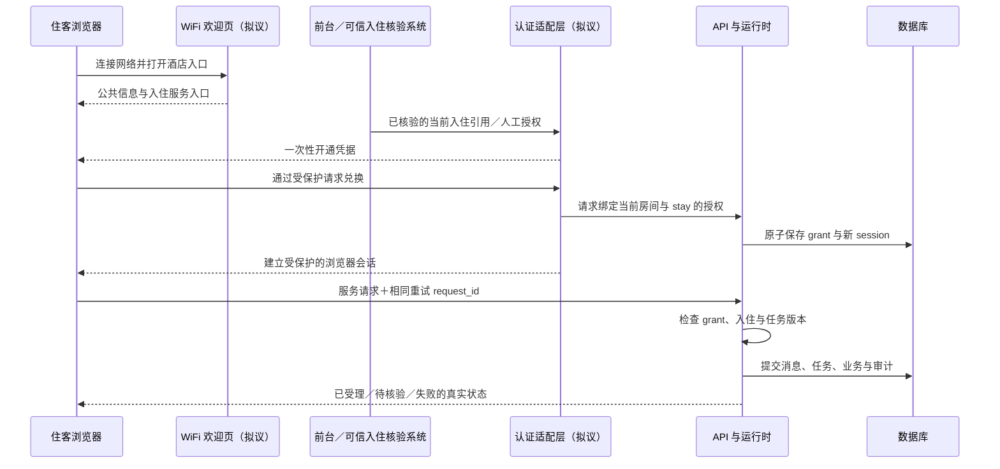

# 入住数据、身份入口与日常运营说明

本说明面向酒店负责人、前台和后续实施人员，核对日期为 2026-10-25。它回答“客人从哪里进来、系统记住什么、多人同时使用怎么办、夜审究竟做什么、未知服务和坏案例如何处理”。代码事实以当前实现为准；标为“拟议”的字段、表、流程和期限均是后续设计，本次没有接入 WiFi、实名核验、真实 PMS、Redis 或自动训练。

当前验收仍是 `offline-code-baseline`，现场状态仍为 `NOT_VERIFIED`。外部集成的权威边界见[未来集成规格](../spec/future_integrations.md)，当前存储与提交边界见[架构规格](../spec/design/architecture.md)。本说明不把这些 `planned` 项目改成已完成。

## 先把几个容易混淆的问题说清楚

| 问题 | 当前已经实现 | 拟议的落地方式 |
| --- | --- | --- |
| 连接酒店 WiFi 后能直接办理房间服务吗？ | 没有 WiFi 门户集成；部署工作台使用访问凭证 | WiFi 提供入口，入住核验之后才给私人会话和服务权限 |
| 输入身份证号就能登录吗？ | 没有身份证验证接口；`identity_checked` 是员工确认，不是系统验证结果 | 不把身份证号当密码；证件核验留在酒店既有可信系统，助手只接收核验结果和入住关联 |
| 下次入住还记得上次聊天和喜好吗？ | 已有 `stay_id` 隔离、旧凭证撤销和提交前复核；没有跨次入住画像系统 | 每次新入住从空白会话与偏好开始；同一个人再次到店也不自动取回旧聊天 |
| 消息应该放数据库还是 Redis？ | 可配置 SQLite；未配置时为进程内存；没有 Redis | 当前继续用数据库做持久来源，Redis 如有需要只承担可重建的短期状态 |
| “并发 8”意味着能服务多少客人？ | 线程池默认 8 个执行线程，未完成任务上限 128 | 这是执行参数；实际可承诺人数和延迟要通过现场负载验证 |
| 夜审等于完成结账了吗？ | 只推进本地业务日、处理少量房态和当日券使用计数 | 真实账务日结交给 PMS；助手接回执与差异，不自行判定财务结清 |
| 客人问按摩、洗浴，系统能否自己补充答案？ | 已有三态服务配置和实时库存查询；默认按摩、泡澡均为 `unconfirmed`，不调用模型猜目录事实 | 后续补齐酒店审批、证据有效期和正式核验流程 |
| 收集坏案例是不是自动训练？ | 已有预置难例、Few-Shot 检索和会话内服务需求计数；没有酒店全局审核与自动发布闭环 | 脱敏、审核、独立评测后，才可能发布知识或提示候选；不自动训练模型参数 |

## 1. 房间、一次入住、聊天窗口是三件事

`room_no` 表示一间物理客房；`stay_id` 表示一次入住；`session_id` 表示该次入住下的一段受保护会话。房号可以重复分配给下一位客人，所以不能用房号作为聊天或偏好的唯一索引。姓名、手机、身份证号也不应成为跨次入住的助手记忆索引。

| 标识 | 当前用途 | 拟议约束 |
| --- | --- | --- |
| `room_no` | 查本地在住台账、限定服务房间 | 房号由核验结果绑定，聊天中自称别的房间不能切换权限 |
| `stay_id` | 绑定当前入住、凭证和业务记录 | 每次重新入住都生成新值，不能复用上一批次 |
| `session_id` | 会话、消息分页、任务与幂等记录的归属 | 每个设备或独立住客分别授权；不因同住一间房就共享逐字稿 |
| `grant_id` | 住客凭证的服务端授权记录 | 可以过期、撤销，且必须仍属于当前有效入住 |
| `request_id` | 同会话内防止重试重复执行 | 同键同载荷复用结果，同键不同载荷拒绝；不能换键盲目重试未知结果 |
| `run_id` / `task_id` / `version` | 一次执行、一个业务目标及其修改版本 | 旧版本计算结束也不能覆盖新版本或换客后的状态 |
| `message_id` / `sequence` | 消息去重与历史分页 | 消息查询仍要经过该会话和入住的授权检查 |

以上是当前单酒店模型。后续表结构若加入 `hotel_id`，它应来自服务端部署配置；不能由客人或模型任意指定。它是为未来隔离预留的拟议字段，不表示当前已经支持多酒店。

## 2. WiFi 入口与入住核验：先引导，再授权

### 当前代码的认证链路

`auth.py` 支持管理员令牌、个人岗位令牌，以及 HMAC 签名的住客凭证。住客凭证携带 `session_id + room_no + stay_id + grant_id + expires_at`；签名保证内容没有被篡改，载荷采用 Base64 编码，不是加密容器，不应放入证件或其他秘密。

`server.py` 的 `POST /api/guest-access` 仅允许前台、经理及管理岗位执行，并要求员工填写 `identity_checked=true`；运行时还要求房间处于“在住”。这一布尔值表示员工确认完成核验，代码没有读取证件、查询公安/学校身份源或比对订单。不能把员工勾选框描述成自动实名认证。

`SessionManager.create_guest_access()` 为每次签发生成新的 grant 和会话。默认凭证有效期为 24 小时，可设范围为 1 分钟至 7 天。每次请求除验签、验过期，还通过 `validate_guest_access()` 核对服务端 grant 是否撤销、房态是否在住、当前 `stay_id` 是否一致；写入前又会复核在途任务的入住授权。当前凭证未按订单退房时间自动截断有效期，业务有效性依赖上述服务端检查。

### 拟议方案的选择

| 方案 | 取舍 | 建议 |
| --- | --- | --- |
| 前台完成既有核验后，发放一次性开通码或二维码 | 对现有人工流程改动小；领取与补发仍需前台 | 首阶段优先，沿用当前员工确认后签发的边界 |
| PMS 匹配有效入住，再向已登记渠道验证一次性验证码 | 客人可自助；依赖真实 PMS、验证码服务及失败回退 | 外部沙箱和酒店批准后再接入 |
| 仅凭房号、姓名或身份证号登录 | 这些信息可能被他人知晓，也不能证明当前操作者获授权 | 不采用 |

以下为推荐设计，尚未实施。WiFi 网关只负责把客人引导到酒店 HTTPS 欢迎页；连接同一网络、设备 MAC、IP 地址或定位均不构成入住身份。欢迎页可以展示已核验的公共信息；查看个人工单、历史或办理房间服务之前，必须开通入住授权。

拟议的一次性开通记录只保存随机挑战的哈希、当前 `stay_id`、允许开通范围、到期时间、已消费时间、失败次数和核验来源。建议有效期 2 分钟、失败最多 5 次，数值尚待酒店核定；兑换要原子消费，并再次检查当前入住，换客后旧码不能继续兑换。二维码可以只携带随机挑战；短数字码须额外绑定发起浏览器和挑战，避免成为全酒店可穷举的入口。补发不复用旧会话凭据。

完整身份证、证件照片及核验原始响应留在酒店既有受控系统，不进入聊天输入、LLM、Few-Shot、Trace、访问 URL 或助手日志。助手只保存 `verification_reference`、`verified_at`、核验来源与操作人等最小证明；即使未来必须采集证件，也应由独立核验页面直达可信后端，不能通过聊天上传。客人主动把证件贴入聊天时，拟议入口应先拦截、脱敏并引导到核验渠道，不能先发给模型再清理。

正式浏览器会话拟议采用服务端随机会话句柄和 `Secure + HttpOnly + SameSite` cookie；写请求同时做 CSRF 防护。长期 bearer 凭证不放二维码 URL、浏览器历史或日志；WiFi 内嵌浏览器切换到普通浏览器时，使用重新核验或受保护的一次性兑换流程。当前 API 仍使用 `Authorization: Bearer`，没有实现这套 cookie/CSRF/门户流程。上述设计依据 OWASP 对 HTTPS、cookie 属性及 URL 会话标识泄漏的说明，具体接入还需验证浏览器与网关行为。[OWASP 会话管理指南](https://cheatsheetseries.owasp.org/cheatsheets/Session_Management_Cheat_Sheet.html)

## 3. 数据库与 Redis 怎么分工

数据库负责“重启后仍要找得到、出问题能核对”的内容；Redis 适合“过一会儿自动失效、丢了能重建”的短期内容。是否引入 Redis 由实际负载和运维能力决定，不是做聊天系统的前提。

### 当前存储：SQLite 或进程内存

配置 `AEGIS_DB_PATH` 后，`persistence.py` 使用 SQLite，WAL、`synchronous=FULL`、10 秒 busy timeout，以及同路径 `.writer.lock`。检查点事务通过 `BEGIN IMMEDIATE` 和 `aegis_revision` 比较把业务、会话、执行记录、消息及审计一起保存；异常时由运行时恢复内存业务。没有配置文件库时，这些状态主要在进程内存，重启不提供持久恢复。

| 当前表 | 保存的内容 | 需要知道的限制 |
| --- | --- | --- |
| `aegis_business_state(state_key, value_json, updated_at)` | 房态、库存、工单、延退、券台账、日期、grant、回收待检 | 目前是按业务集合存 JSON，不是完整关系型 PMS |
| `aegis_sessions(session_id, state_json, client_type, ttl_seconds, updated_at)` | 会话黑板、待补槽、称呼状态、摘要、任务、`service_feedback` 等 | 当前 `stay_id` 在 JSON 中；TTL 不等同消息保留政策 |
| `aegis_runs(run_id, session_id, data_json)` | 执行状态、请求内容、`request_id` 与结果 | 持久幂等通过读取该会话的 JSON 记录查找，没有单独的 `request_id` 唯一列 |
| `aegis_messages(sequence, message_id, session_id, data_json)` | 按消息 ID 去重的历史归档 | 当前表按 session 查询，`sequence` 支持 `before + limit` 分页 |
| `aegis_audit(sequence, timestamp, actor, action, target, detail_json)` | 业务操作与处置审计 | 不是财务账簿，也不是长期聊天画像 |
| `aegis_revision(id, revision)` | 检查点版本 | 配合单写入者拒绝过时覆盖，不能当多进程分布式锁使用 |

`hotel_core.py` 会在黑板消息超过 12 条时保留最近 6 条，并把被裁掉消息中最近 4 条各截取 25 个字符拼成 `rolling_summary`。这是简单压缩；完整历史由运行时归档和消息分页承担。它不训练参数，也不构成可跨次入住使用的长期偏好。

Streamlit 的 `st.session_state` 绑定 WebSocket，浏览器刷新等操作可使它重置。因此页面中的滚动位置、输入草稿和临时显示状态可以放在那里；入住权限、已确认服务和持久消息应从受保护 API 恢复。当前部署界面也已经通过 API 查询消息历史。[Streamlit Session State 官方说明](https://docs.streamlit.io/develop/api-reference/caching-and-state/st.session_state)

### 拟议的持久结构

后续先在现有 SQLite 中明确字段与生命周期即可；不必为文档中的设计立刻迁移数据库。若容量与多人写入需求超出单写入者方案，再单独评估关系数据库、事务和任务调度的迁移。以下是逻辑表设计，不是已执行的迁移。

| 拟议表 | 关键列与索引 | 目的 |
| --- | --- | --- |
| `stays` | `(hotel_id, stay_id)` 主键；`room_no, status, source_version, checked_in_at, ended_at, verification_reference` | 记录入住批次；房间当前有效占用要有唯一约束 |
| `stay_sessions` | `(hotel_id, stay_id, session_id)` 唯一；`status, created_at, last_seen_at, closed_at, purge_after` | 所有历史查询先限定酒店、入住与会话；权限来自服务端 |
| `guest_grants` | `grant_id` 主键；关联同一 hotel/stay/session；`expires_at, revoked_at, auth_version` | 持久撤销和换客失效；不保存证件或长期 bearer 明文 |
| `conversation_messages` | `message_id` 唯一；索引 `(hotel_id, stay_id, session_id, sequence)`；`role, content, created_at, retention_policy_id` | 同次入住分页、去重与按批准期限删除 |
| `stay_preferences` | 唯一 `(hotel_id, stay_id, session_id, preference_key)`；`value, explicit_source, updated_at, expires_at` | 只记住本会话明确表达的称呼、沟通偏好；不推测身份、健康或长期喜好 |
| `task_runs` | 唯一 `(hotel_id, session_id, request_id)`；`payload_hash, task_id, version, status, result_reference` | 在持久层拒绝同键不同请求，保留已确认执行的重试身份 |
| `identity_challenges` | `challenge_hash` 唯一；`stay_id, expires_at, consumed_at, attempts, verifier_reference` | 一次性兑换、限制尝试、审计；原始挑战不入日志 |
| `retention_jobs` | `job_id, scope_reference, policy_id, due_at, status, receipt_hash` | 按审批政策删除正文和派生摘要，并证明处置 |

新设计里消息、偏好与派生摘要都必须能追溯到本次 `stay_id`。不能只在前端隐藏旧记录，后台查询和模型上下文组装也必须带同样的范围。偏好默认不在同房不同住客间共享；跨设备恢复同一会话需要显式授权，不能凭房号合并。

### 拟议的 Redis 键：仅在有需要时增加

Redis 支持 RDB 快照与 AOF 日志；持久性取决于配置，不能把“放 Redis”理解成天然不会丢。RDB 可能丢失最近快照后的写入，AOF 每秒同步也存在最近写入的丢失窗口。因而本方案把已确认消息和工单仍保存在数据库。[Redis 持久化官方说明](https://redis.io/docs/latest/management/persistence/)

以下键名均为拟议，`{…}` 是内部随机标识或不可逆引用，不含身份证、电话或姓名：

| 拟议键 | 内容 | 生命周期与失败处理 |
| --- | --- | --- |
| `aegis:{hotel}:session:{stay}:{session}` | 最近访问时间、UI 恢复提示、已提交版本 | 例如空闲 30 分钟；丢失后从数据库和有效 grant 恢复 |
| `aegis:{hotel}:context:{stay}:{session}` | 已批准使用的本次入住近期上下文缓存 | TTL 不超过会话及入住有效期；数据库来源版本不符即重建 |
| `aegis:{hotel}:challenge:{challenge_hash}` | 短期挑战的消费辅助状态 | 2 分钟建议值；最终兑换状态仍由数据库原子消费决定 |
| `aegis:{hotel}:rate:{grant_hash}:{window}` | 请求计数 | 短 TTL；丢失或故障时执行 API 本地保护或收紧入口 |

TTL 可由 Redis 的 `EXPIRE` 等机制实现，键到期会删除；应用仍须独立检查 `expires_at` 和入住状态，不能用缓存键是否存在代替授权。[Redis EXPIRE 官方说明](https://redis.io/docs/latest/commands/expire/)

缓存还可能因内存策略被提前淘汰；`noeviction` 虽不淘汰键，内存不足时会拒绝部分写入。因此不可把 Redis 中的撤销标记、幂等键或最后一份聊天正文当唯一证据。数据库不可用时不确认新的业务提交；Redis 不可用时，能安全回到数据库的功能继续，认证挑战等无法验证的入口拒绝兑换。这里是基于 Redis 行为作出的方案选择。[Redis 内存淘汰官方说明](https://redis.io/docs/latest/develop/reference/eviction/)

缓存采用数据库成功提交后再失效或更新的顺序，不能先把 Redis 写成成功再补数据库。Redis 也不会自动解决当前 Python 内存业务状态的一致性，加入它不构成启用多个 API writer 的理由。

## 4. 一次入住从开通到结束，数据怎么走

| 事件 | 当前代码行为 | 拟议补齐的生命周期 |
| --- | --- | --- |
| 前台登记新入住 | `register_stay()` 校验房间、称呼、订单编号和日期；原房仍在住须明确更替；若存在该房“处理中”工单则拒绝；生成新 `stay_id` 并撤销该房全部旧 grant | 接入可信订单核验后，同事务关闭旧入住授权、废止旧挑战，并记录来源版本 |
| 客人开通服务 | 每次签发生成新的 `session_id`，绑定当前入住；新会话的 `service_feedback` 为空 | 新黑板、空摘要、空偏好；不按姓名/证件查找旧入住内容 |
| 同次入住刷新页面 | 页面会话可能消失；API 可按仍有效凭证读取数据库历史 | 重新认证后恢复自己原会话；浏览器 cookie 的恢复机制需单独实施 |
| 会话空闲 | 普通会话默认 1800 秒；启用持久化时只从内存卸载，下次可恢复；自助机默认 30 秒会执行 reset；无数据库的普通过期会话也 reset | 分清空闲时限、凭证绝对到期、入住结束、档案保留四种时钟 |
| 主动清空会话 | reset 取消该会话未完成运行、移除上下文；当前可删除会话/run/message 记录 | 页面需说明清空聊天不等于取消已提交工单；业务取消仍走各自流程 |
| 办理续住 | 当前礼宾处理器受房态与政策规则约束 | 若 PMS 认定仍为同一次入住，可保留本次会话；权益和凭证期限重新核验，不能自行无限延长 |
| 退房或换客 | grant 校验和提交前校验会拒绝不再有效的入住；新登记撤销旧 grant | 正式退房事件应显式关闭 stay、撤销授权、使在途 worker 失效、清缓存并排保留处置任务 |
| 同一客人再次到店 | 没有按个人身份自动恢复旧聊天的功能 | 一律新 `stay_id`、新会话、空偏好；不自动复用“上次喜欢什么” |

需要区分“无法再访问”和“已经删除”：当前新入住不会自动删除旧会话、旧消息或业务记录；旧上下文可能仍在存储中，但旧 grant 不能继续访问当前入住，也不能再提交旧 worker 的结果。当前 TTL 不是统一的退房归档/删除调度，更不是跨次入住记忆开关。

拟议保留策略应由学校/酒店批准并形成 `retention_policy_id`：明确聊天正文、摘要、临时偏好、工单及审计各自的用途与期限。退房立即停止个人上下文使用并清理缓存，正文及派生摘要按获批期限删除；财务或服务审计可按独立政策保留最小字段，不能把它重新拼回下一次入住的模型上下文。删除任务需覆盖备份的保留和恢复后的再删除规则。此处没有替酒店确定法定保留天数。

“本次入住助手记住不使用姓名称呼”属于当前会话状态；“下次见到这个身份证就仍这样称呼”属于跨次入住画像，本方案不做。即使旧记录按政策留档，留档也不等于允许用于个性化或模型改进。

## 5. 当前的并发到底做了什么

可以把现有运行时理解成：多位客人的需求可以同时理解，但真正修改库存和房态时，要检查最新情况并按事务提交。

1. `SessionManager` 默认有 8 个执行线程、最多 128 个未完成任务、最多 256 个驻留会话；排队与驻留会话不是同一个计数。API 对住客凭证另有每分钟 20 次请求限制。它们都是实现保护参数，不是生产容量结论。
2. 不同会话可以并行执行。同一会话通常一次推进一个运行，其余排队；取消、替换等控制指令有专门路径，可以让旧任务失效或推进新版。取消不会强行结束线程里已开始的网络计算，而是阻止旧结果提交。
3. worker 先复制黑板和库存，在短锁之外理解需求或调用模型；部门处理器产生提案，不能直接成为共享业务事实。提交时重新检查当前任务、版本、会话 owner、入住与 grant。
4. `_commit()` 比较业务日、房态字段、工单归属及前值、库存前值和非负性；运营人员已经改过的状态不能被旧快照覆盖。发生提交冲突时重新取快照计算，总尝试预算为 `max(3, min(max_workers, max_pending) + 1)`，默认 8 个线程时为最多 9 次尝试；仍无法提交或存储失败时不承诺操作成功。这是有界冲突处理，不保证任何竞争负载都能成功，也不是酒店全局优先级调度队列。
5. 同一个 `session_id + request_id` 的重试复用同一执行，同键不同内容拒绝；已完成记录可从 SQLite 恢复。`202` 表示已受理，`completed` 表示本次执行结束，都不等于实物已经送达、延退已经批准或券已真实签发。

当前只有一个 API 进程拥有业务写权限，SQLite writer 锁会拒绝第二个写入者。不能通过增加 `--workers` 或复制服务绕开限制；8 个线程也不表示 8 个部门模型在同时自主协商。现场人数、模型延迟、队列等待和磁盘写入表现仍依赖 `FIELD-02` 的实际验证。

## 6. 夜审：当前是本地业务日滚动

酒店的“业务日”是运营和记账的日期，不必等同于电脑过了零点的自然日。以 Oracle OPERA Cloud 为例，End of Day 是一组按顺序关闭当前业务日的流程，涉及到离店检查、房费/套餐过账、账本平衡、统计及报表；推进业务日只是其中一步。不同酒店启用的流程还取决于其配置。这是行业产品的例子，不表示本系统实现了这些能力。[Oracle OPERA Cloud：About End of Day](https://docs.oracle.com/en/industries/hospitality/opera-cloud/25.1/ocsuh/c_endofday_procedures.htm)

当前 `hotel_core.run_pms_night_audit(pms_rooms, current_date)` 只做以下动作：

| 条件 | 当前实际变化 |
| --- | --- |
| 每次调用 | 本地业务日加 1 天；不是自动读取自然日直接跳到今天 |
| 房态为“在住”，且 `checkout_date <= 调用前业务日` | 标记“超时待结”，提醒前台核对；不是已结账或已退房 |
| 房态为“在住” | `daily_voucher_used` 清零，包括本轮刚被标成超时待结的房间；不代表真实券系统已处理 |
| 房态为“空房清洁中” | 自动改成“空房可用”，记录一条夜审保洁归档动作 |
| 其他房态 | 不由该函数进一步结算或释放 |

该比较使用调用前业务日。例如退房日为 D，在 D 日夜审时会变成“超时待结”；退房日为 D+1 则不会在这一轮标记。函数对非法 `current_date` 还保留了回退到合成基准日的容错，这不应作为真实 PMS 日期修复策略。

`SessionManager.night_audit()` 在共享锁和持久化事务内调用它，更新各驻留会话业务日并附加动作记录。受保护的 `POST /api/pms/night-audit` 要求前台/经理岗位及 `expected_date`；日期已变化会拒绝，防止同一旧页面重复跨日。它没有独立的每日调度器，也没有完整财务日结回执；如果操作者刷新日期后再次执行，代码仍可再推进一天，因此不能把这个入口直接接成未经核验的定时任务。

当前夜审不计算房费/税费/押金，不核对收银和支付，不生成真实账单/发票，不处理外部 PMS 的未到店、未结账或换房清单，不创建新的 `stay_id`，也不归档或清空住客聊天。它还会把“空房清洁中”自动置为可用；真实运营若要求保洁完成及查房签字，这个默认动作需要在接入前改为经核验状态，不能用跨日代替查房回执。

拟议生产方案是读取真实 PMS 的业务日和夜审结果，由酒店既有 PMS 完成财务日结；助手仅记录 `provider_business_date`、`audit_run_id`、阶段、回执版本与待人工处理的差异。对未收到确定回执的操作保持“待确认”，不自行冲账、关单或释放房间。夜审日期变化与新入住开始是不同事件，不能在每次夜审时重置仍在住客人的全部会话。外部契约与对账仍属于 `FUT-01`。

## 7. 服务和设施必须来自酒店核验目录

### 当前已实现的最小目录

`hotel_catalog.py` 读取 `data/service_catalog.json`。文件现含 24 种物品的名称、单位、分组、初始库存及部分借用标记；`inventory_basis` 明确写的是合成初始库存，不能把这些数值当成学校酒店已盘点的实物。实际咨询读取 `HousekeepingAgent.inventory`，不是直接把 `initial_stock` 当实时余量；通用物品清单只列库存大于零且不是早餐券的物品。academic 餐券仍受入住待遇核验约束，目录里出现“早餐券”不代表真实发券权限。

当前服务数组使用 `name, aliases, status, source`。默认“按摩服务”（含 SPA、水疗别名）和“泡澡设施”（含泡澡、泡浴、浴缸别名）均为 `unconfirmed`，没有声称学校酒店实际提供或不提供它们。配置加载器检查状态枚举，并要求 `available`、`unavailable` 有非空 `source`；它尚未验证出处真实性、审批人、营业时段或证据有效期。

`HotelOrchestrator._catalog_reply()` 对已匹配的服务及物品目录问题走本地规则，读取配置和实时库存，不调用 LLM 生成目录事实；含明确故障/危险信号的输入继续交给原有处理链路。它不创建预约，也不因介绍物品清单就创建送物工单。服务别名未命中时并非自动创建目录候选；当前还不是覆盖任意未知服务的通用核验系统。

| 当前 JSON 的 `status` | 当前程序行为 | 后续治理要求（拟议） |
| --- | --- | --- |
| `available`：配置为可提供 | 提示当前配置可提供，时段、房型、费用、预约仍需前台确认；不创建预约 | 本酒店负责人批准，证据在有效期内，适用范围明确后才保持此状态 |
| `unavailable`：配置为不提供 | 说明当前不提供，并记录本会话需求计数；不自动开放或预约 | 由负责人确认不提供或暂时停用，并说明时限和出处 |
| `unconfirmed`：待核验 | 说明可用情况尚未核验，记录本会话需求计数并引导前台；不建服务工单 | 对缺资料、过期、矛盾或语义不清分别核验，不能默认改成可提供或不提供 |

配置和文档统一使用 `unconfirmed`；“未知”只是业务含义，不是当前 JSON 中另一个 `unknown` 枚举。当前没有自动过期、冲突判定或完整审批机制；后续可以增加 `not_configured / expired / conflicting / ambiguous` 等核验原因，但不能据此自动发布服务事实。

当前 `HotelKnowledge` 仍从知识文件读取其他 FAQ，`AEGIS_SITE_PROFILE=academic` 默认使用学校模板；standard 使用演示知识。standard 中的“客房淋浴/热水”条目不证明真实酒店经营公共洗浴、SPA 或按摩。学校模板对设施开放、位置和收费也要求前台核实。送物还有独立目录与库存护栏，未知物品不会因为模型猜到了名称就扣库派单。后续应让按摩、泡澡、公共洗浴、客房淋浴分别具有明确范围；“能洗澡吗”语义不清时先澄清，不能从淋浴模板推断存在经营性洗浴服务。

### 尚未实现的完整目录治理

拟议 `hotel_service_catalog` 保存 `hotel_id, service_id, aliases, availability_status, scope, booking_mode, approved_answer, location, hours, price_policy, source_reference, owner, approved_by, verified_at, valid_until, version`，其中 `availability_status` 沿用 `available / unavailable / unconfirmed`。这比当前 JSON 多出的审批、范围、有效期和版本治理仍是设计。未核验字段为空并触发核验；服务状态和营业时段分别检查。运营人员可从正式待核验队列形成候选，只有授权负责人批准后才发布新版本；运行时再同时核验服务可用性、当前时段、权限和业务写入条件。

实际回复由结构化事实约束。例如没有按摩资料时可以说“这项服务尚未核验，我可以请前台确认”；只有酒店明确确认不提供时，才说“酒店目前不提供这项服务”。客人说“上次你们有”、模型常识、网页搜索摘要及被重复询问的次数，都不能成为本店提供服务的证据。

## 8. 收集不知道的问题与坏案例，不等于自主训练

当前 `harness/self_evolution.py` 的 `HardCaseMiner`、`DynamicExemplarCurator` 可读写本地难例和示例文件；示例检索使用 `SequenceMatcher` 字符相似度，选少量 Few-Shot 加入意图提取提示。这不是向量检索，不修改模型权重。服务端没有自动把真实住客逐字稿写入这些文件的链路。`EvolutionDeltaRunner` 当前做固定基线和预置难例回归，`evolution_delta=null`，没有前后对照实验，不能宣称已经证明持续学习或质量提升。

### 当前已实现：会话内的服务需求计数

命中配置中 `unavailable` 或 `unconfirmed` 的服务时，`_catalog_reply()` 按服务名称在本会话的 `HotelState.service_feedback` 中新增或更新记录：`topic, catalog_status, status="待酒店核验", count, last_seen_at`。记录只保存主题、配置状态、次数和时间，不复制原始问题；正常会话消息仍按既有归档逻辑保存，不能因此宣称聊天正文完全没有存储。`available` 服务目前不生成这类反馈。

`SessionManager` 已将 `service_feedback` 纳入会话持久化字段及差量提交，所以同一会话恢复后可保留计数；新入住签发的新 grant 对应新会话，计数从空开始，不自动读取旧住客兴趣。该字段不是长期偏好画像，也不是酒店全局需求库：目前没有跨会话汇总、负责人分派、审核状态流转、审批界面或自动发布。对 `unavailable` 的计数表示可供酒店评估的需求，并不推翻配置中“不提供”的事实。

### 仍属拟议：正式知识与失败案例审核队列

后续可在当前计数之外设置两类独立队列，均由授权人员查看，采集失败不阻塞住客请求；不能将 `service_feedback` 的“待酒店核验”文案当成下列管理流程已存在：

| 拟议队列 | 收什么 | 能推出什么，不能推出什么 |
| --- | --- | --- |
| `knowledge_review_queue`：未知知识/服务 | 脱敏问题类别、服务候选词、命中情况、目录版本、原因、次数与时间桶 | 能表明“有人问且当前答不了”；不能表明酒店确实有该服务 |
| `failure_review_queue`：失败/歧义案例 | 脱敏输入、预期与实际行为、解析/工单状态、风险标签、规则/模型/知识版本、来源事件不可逆引用 | 能帮助复现分类、取消、权限、错误承诺等问题；不能自动成为正确答案或黄金示例 |

建议共同字段为 `sample_id, source_event_hash, data_use_basis, redaction_version, category, expected_behavior, actual_outcome, risk_tags, owner, review_status, created_at, delete_after`。用带密钥的不可逆事件引用关联受控审计，不把房号、姓名、电话、证件、token、券码和原始会话 ID 当公开去重键；自由文本也需检查，不能只删固定字段。

处理顺序遵守 `FUT-06`：`quarantined → redacted → reviewed → approved/rejected → released/retired`。来源未授权、脱敏失败、审核分歧或测试集污染时留在隔离/拒绝状态，超时不能自动批准。原始材料如确需短暂隔离，其默认上限和访问权限沿用 FUT-06 的设计（最多 7 天，仅治理负责人）；脱敏样例、审核及发布记录也按该规格与学校批准的期限执行，不复制成无限期聊天档案。

审核要分清三条结果：

1. **酒店事实更新**：负责人用通知、合同、设施清单等可信来源核实服务，批准目录或 FAQ 新版本；客人反馈只是线索。
2. **程序或提示改进**：工程人员根据脱敏坏案例修规则，或制作不含个人资料的提示候选；通过冻结独立集、安全边界及回滚验证后，由人工发布。把同一案例同时放入候选和独立测试会造成证据污染。
3. **模型训练**：微调等参数更新是另一个明确立项的数据处理流程，需要单独授权、数据集、评测与发布；当前没有这项实现，本方案也不自动启动它。

改进可以积累“怎么理解一种表达”的通用经验，前提是来源获准、去标识并经过发布审核；它不能积累“某个住客喜欢什么”的跨次入住记忆。样例获批不自动改变酒店服务事实，知识获批也不能跳过入住鉴权、权益审批、库存与提交护栏。没有独立对照支持提升时，应写“未证明提升”。

## 9. 实施前还要由酒店确认的事项

以下是待确认输入，不是本次已经获得的配置或批准：

| 待确认项 | 责任方与产物 | 未确认时的行为 |
| --- | --- | --- |
| WiFi 网关是否支持跳转、HTTPS、普通浏览器继续访问 | 酒店网络管理员：网关能力和合成设备验证记录 | 使用普通链接或前台引导，不把网络连接当认证 |
| 可信入住来源、同住客分别授权、续住/换房/退房事件 | 前台与 PMS 负责人：字段、顺序、核验及撤销契约 | 保留人工核验，不能自动接收未经确认的入住映射 |
| 验证渠道和开通方式 | 前台与安全负责人：一次性码/可信渠道的发行、消费、补发与限流规则 | 沿用受保护的人工签发，不以身份证号单独登录 |
| 按摩、洗浴、淋浴、停车、餐饮等真实目录 | 各服务 owner：三态、范围、出处、价格、时段、有效期及审批 | 继续按 `unconfirmed` 表达待核验；过期自动降级等规则仍需实施 |
| 真实夜审、查房、可售房态与财务边界 | 前台、客房及财务：PMS 操作责任和确定回执 | 本地跨日不得被当作财务日结或查房证明 |
| 聊天、偏好、工单、审计及备份的使用与期限 | 学校/酒店治理负责人：用途、访问人、保留与删除政策 | 不启用跨次入住画像，不把逐字稿自动用于训练 |
| 样例采集的合法依据、脱敏及双人审核 | 数据治理与评测负责人：FUT-06 阶段准入和独立集 | 不自动收集发布真实逐字稿，不自动生成已批准知识 |
| 并发、延迟、故障恢复目标 | 运维与验收负责人：FIELD 实测证据 | 继续单 API writer，不承诺线程数对应的生产容量 |

建议实施顺序是：先核实服务目录与入住/保留规则，再做人工核验后的入口和新入住隔离，随后做外部 PMS/验证码沙箱、撤销及故障演练，最后依据容量证据决定是否增加 Redis。真实系统接入、数据使用、上线状态和发布门槛仍按 `FUT-01/02/04/05/06` 与现场协议推进；本文件仅提供可评审的落地设计。
