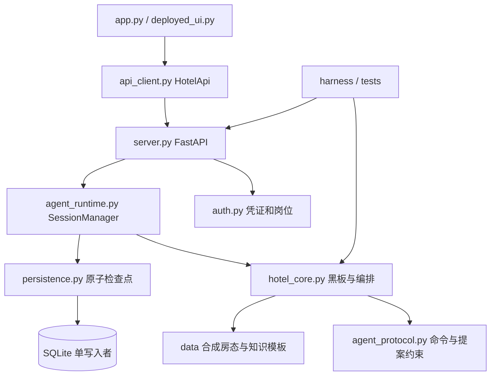

# 学术酒店详细架构规格

上级：[主规格](../specification.md)。配套：[业务](business.md)、[实验](../experiments.md)、[验收](../acceptance_criteria.md)、[追溯](../traceability.md)。本文为当前实现，现场容量、外部 PMS、学校 SSO 和真实恢复不是已验收能力。

## 模块与依赖

hotel_core 无 Streamlit 依赖。部署分支进入 API 工作台，只通过 HotelApi 访问唯一服务端。本地无 API 的演示仍有独立 runtime，只能用于开发；部署不能开第二 runtime 同写库。

接待负责理解/FAQ，保洁负责送物/改物，工程负责诊断/安全建议，礼宾负责续住/餐券记录，经理负责严重客诉。DispatchAgent 保留兼容门面。处理器不各自拥有可提交的会话真相，但保洁持有带锁库存，不能描述成所有 Agent 完全无状态。

## 黑板与数据归属

对应 REQ-01、REQ-02、REQ-10。HotelState 为会话工作黑板，SessionManager 拥有共享业务及提交，配置文件库后 SQLite 为恢复来源。

| 数据 | 标识与归属 | 恢复与可见性 |
| --- | --- | --- |
| 接待上下文 | room_no、intent、pending、sentiment、profile、active_agent | 会话检查点，不泄漏其他会话 |
| 消息/摘要 | messages、rolling_summary、message_id | 近期窗口在黑板，按 session 完整归档，可 before/limit 分页 |
| 在住台账 | shared_pms；room_no + stay_id | 共享检查点，部门字段最小化；初始合成数据不是外部 PMS |
| 工单 | ticket_id、task_id/version、owner_session_id、stay_id | 共享业务，住客按入住/会话过滤 |
| 延退申请 | request_id + stay/session | 审批匹配当前申请与入住 |
| 餐券台账 | voucher_id + owner_session_id/stay_id | academic 只待核验，无外部券系统 |
| 库存/借用/回收 | inventory、borrowed_items、quarantine | 提交前核对，已送达回收待检 |
| 凭证 | grant_id、session_id、room_no、stay_id、expires_at、revoked | 签名之外仍核对运行时 grant |
| 任务 | TaskRun 与 tasks；run_id、task_id、version、request_id | 运行对象在内存，持久记录支持幂等/重启 |
| 冲突/Trace/审计 | agent_conflicts、last_trace、audit | 解释决策与 actor/action/target，不替代外部审批凭证 |

换客不复用旧会话；新 stay 使旧 grant 与旧 worker 失效。消息归档分层不表示学校已批准无限期保留真实资料。

## 任务执行与提交

对应 REQ-05、REQ-08、REQ-09。默认线程池 max_workers=8、未完成任务上限 max_pending=128；这是实现参数，不是实测容量。普通会话 TTL 1800 秒、自助机 30 秒，也不是住客凭证有效期。

1. API 核对身份/会话/房间及限流，运行时拒绝空消息、关闭、存储错误或队列满。
2. 同 session + request_id 先查内存再查持久 run；同载荷复用，冲突载荷拒绝。裁剪内存不能丢失持久重试身份。
3. 送物取消/替换定位 task/ticket，保持 task_id 并递增 version。同会话受当前任务与队列控制，不同会话可并行理解。
4. worker 在黑板/库存快照执行；共享锁用于快照、判定和提交，耗时理解不一直占锁。
5. 提交前 _is_current 再验版本、owner 和入住授权；取消/替换/吊销/换客后的旧运行 superseded，不发布副作用。
6. _commit 检查业务日、会话前值、房态字段、工单前值及归属、库存前值和非负性，再应用差量。不能覆盖运营端新状态。
7. 业务、完成消息、任务、幂等与审计落库后返回。数据库异常回滚内存业务，run_status=failed 且回复未提交；HTTP 200 不等于业务成功。

运行状态有 queued/running/completed/needs_review/superseded/failed；业务任务另有 awaiting_input/submitted/awaiting_confirmation/cancelled。completed 仅指本次执行结束，不代表权益获批或实物送达。Trace version_checked 不能单独替代业务断言。

## 部门提案边界

对应 REQ-07、REQ-11。_verified_department_ticket 在复制黑板和库存上调用处理器，再经 validate_department_ticket 与额外校验：

- 工单结构、唯一标识、初始状态，房号/类别/部门与契约一致。
- 优先级不低于当前风险下限，高风险保持红色。
- 送物 item/quantity 与命令一致；预留量、剩余量、库存状态、待派送状态与变化可重算，不能改其他物品。
- 借用品标志及新增借用记录的 ticket/room/item/quantity 与本单一致。

通过后才回写复制库存及借用增量；否则记录 agent_conflict 待人工，原副作用不提交。academic 餐券还在规则入口转票券服务、保洁 dispatch 库存操作前拒绝、revise 改券时保留原单。范围是本次已知表达和直调路径，不是任意自然语言安全证明。

模型工具 JSON 只是建议，不能绕过 create_hotel_ticket 和运行时提交。人工冲突核验只处理记录，不把错误提案自动变成工单。

## 持久化与恢复

对应 REQ-08…REQ-10。SQLiteStateStore 用同路径 .writer.lock 排他锁，Windows 为 msvcrt，其他平台 flock；第二写入者拒绝启动，不支持多进程横向写扩展。

SQLite 使用 WAL、synchronous=FULL、10 秒 busy timeout；检查点 BEGIN IMMEDIATE 并比较 aegis_revision，同事务写入：

| 表 | 数据 |
| --- | --- |
| aegis_business_state | 房态、工单、申请、券、库存、日期、grant、待检 |
| aegis_sessions | 工作黑板、TTL、活跃时间 |
| aegis_runs | 运行与 request_id 幂等记录 |
| aegis_messages | 唯一 message_id、会话消息和序号 |
| aegis_audit | actor/action/target/detail/时间 |
| aegis_revision | 防过时写入版本 |

会话写失败须连同业务整体回滚；员工事务也恢复内存。写故障后 /ready 不就绪，暂停新提交，不能用内存成功掩盖落库失败；/health 只说明进程存活。

启动恢复共享业务、日期和会话；已持久日期优先于环境初始日。恢复 running 标 interrupted，不重放副作用；已完成 request_id 仍复用原 run。保留和销毁周期需学校治理。

备份使用 SQLite backup API 并校验完整性，拒绝覆盖目标。恢复须停 API，保留现库及 WAL/SHM 后按 [运维手册](../../docs/operations.md) 替换，禁止混用旧 WAL。测试备份重开不等于现场恢复演练。

## 部署与配置

对应 REQ-13、REQ-14。AEGIS_DEPLOYED=1 强制鉴权/持久化；API 工作台配置 AEGIS_API_URL。manage.py init 生成独立随机配置并拒绝覆盖，真实密钥/岗位令牌不入 Git。

| 配置 | 含义与边界 |
| --- | --- |
| AEGIS_SITE_PROFILE | academic 学校政策/知识；缺省 standard，部署显式核对，不可进程内动态混用 |
| AEGIS_DB_PATH / AEGIS_BUSINESS_DATE | 文件库和首次业务日；持久日期优先 |
| AEGIS_AUTH_ENABLED / AEGIS_STAFF_TOKEN / AEGIS_SIGNING_KEY / AEGIS_STAFF_KEYS_JSON | 鉴权、独立随机管理员/签名及个人岗位映射；不替代账号治理 |
| AEGIS_PMS_FILE / AEGIS_KNOWLEDGE_FILE | 初始房态/知识文件，加载文件不是 PMS 双向集成 |
| AEGIS_FORCE_RULES | 禁用模型；默认离线验证强制开启 |
| OpenAI 兼容配置 | 可选云辅助，无配置或失败规则降级；真实数据调用须有学校授权 |

Dockerfile 声明非 root；Compose 声明单 API worker、命名卷、独立 Web 内部 API URL、回环绑定和 /ready 健康检查。静态配置不证明容器启动、卷权限、TLS、恢复或现场容量；FIELD 实验仍 TARGET_NOT_RUN。

## 评测与证据

对应 REQ-15、REQ-16。Harness 固定 H01…H20，默认规则，每例重建状态。四指标为意图、应建单槽位、工单部门精确率和召回率，口径见 [验收标准](../acceptance_criteria.md)。20 条全过不能证明任意语言泛化或酒店生产质量。

DynamicExemplarCurator 检索难例/Few-Shot，不训练参数；无独立前后对照时 evolution_delta=null。摘要和示例保存不能描述为持续训练。

统一入口使用新目录，保存原始日志、逐项 ID、JSON、run_id、命令/退出码、哈希和 Git dirty；校验固定案例、状态/Trace。门槛含原始 127 项、核心不少于 40、零跳过、四指标 1.0、16 项追溯。Harness CLI 退出 0 可能有 FAIL，必须看逐行 JSON。

离线执行清除宿主真实 PMS/知识/API 地址等配置，项目 Python、合成数据、临时库，不读取真实库或发云请求。原始日志进 .artifacts/，结论以新 manifest 为准；现场 NOT_VERIFIED 不随离线 PASS 自动提升。
