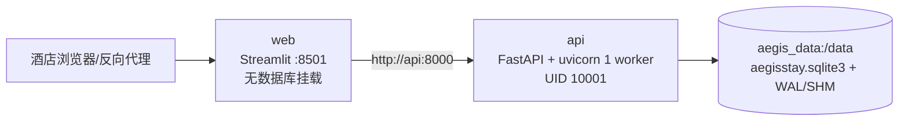

# REQ-14 部署与运维子规格

上级：[主规格](../specification.md)；架构边界：[详细架构](architecture.md)；执行方案：[EXP-14](../experiments.md#exp-14配置备份与容器静态约束-req-14--ac-14)；验收：[AC-14](../acceptance_criteria.md)；追溯：[REQ-14 映射](../traceability.md#req-14--ac-14--exp-14)。运维操作：[值班手册](../../docs/operations.md)。

## 1. 范围、目标与状态

本子规格定义学校学术酒店单酒店部署的配置边界、容器拓扑、SQLite 数据安全、备份恢复、升级回滚、监控审计和上线前检查。它描述仓库当前实现及可执行的验收目标，不把静态文件、离线规则测试或历史记录写成酒店现场通过。

| 项目 | 当前状态 | 解释 |
| --- | --- | --- |
| REQ-14 | `partial` | 本地配置、持久化、备份和负向校验已有代码/测试；Compose 分离进程、卷权限、重启与现场恢复尚未执行。 |
| 离线代码基线 | `PASS`（以最新规格验收记录为准） | 范围是 `offline-code-baseline`，合成数据、临时库和规则模式；`field_readiness` 仍为 `NOT_VERIFIED`。 |
| 离线镜像构建 | `PASS`（CI） | 最近已记录提交的 GitHub Actions `Offline acceptance` 已完成 `docker build -t aegisstay:test .`；可复查记录见[规格体系验收记录](../specification_verification_2026-10-23.md#提交后的-ci-证据)。这只证明 Linux CI 的镜像构建。 |
| Compose 启停与网络 | `NOT_VERIFIED` | 未有当前提交的 `docker compose up`、健康检查、web→api 网络和端口实跑证据。 |
| 数据卷权限与非 root 运行 | `NOT_VERIFIED` | Dockerfile 静态声明已存在；命名卷挂载后 UID、可写性和宿主 ACL 尚未实测。 |
| 进程重启/中断恢复 | `NOT_VERIFIED` | Python 临时库测试证明应用层重启语义；容器重启、SIGKILL、断电窗口和现场卷未演练。 |
| 现场恢复与 RPO/RTO | `NOT_VERIFIED` | FIELD-03 目标尚未执行，不得发布恢复 SLA。 |

`implemented`、`partial` 描述代码范围；`PASS`、`NOT_VERIFIED` 描述指定证据。二者不能互相替代。EXP-14 的本机测试不覆盖 FIELD-01/03；任何上线门禁须同时满足离线门槛和现场门槛。

### 1.1 目标与非目标

目标是让单个 API 进程成为唯一业务写入者，使工作台通过 HTTP 使用它，并能在 SQLite 文件损坏、写入失败、进程重启和配置错误时停止承诺、保留证据并按手册恢复。目标还包括可审计的备份、恢复、升级和回滚步骤。

本轮不实现或验收真实 PMS、学校 SSO、电子券、外部告警、云模型、语义 RAG、多副本数据库和生产容量。`data/` 下的房态和知识文件是合成/模板输入，不是现场 PMS 或批准的学校政策。

## 2. 当前实现边界

* `server.py` 暴露唯一 FastAPI 服务；`deployed_ui.py`/`app.py` 的部署分支通过 `HotelApi` 调 API，不打开 SQLite，不持有第二份可写业务状态。
* `SQLiteStateStore` 以同路径 `.writer.lock` 排他锁拒绝第二个写入者；SQLite 设置 WAL、`synchronous=FULL` 和 10 秒 busy timeout。检查点用 `BEGIN IMMEDIATE`、`aegis_revision` 和单事务写入业务、会话、run、消息、审计。
* 写故障回滚内存业务并把 `/ready` 置为 503；`/health` 仅报告存活/`degraded`，不能作为可写就绪证明。`/ready` 成功响应包含 `{"ready": true, "persistent": true}`。
* 服务重启恢复已提交业务、日期、会话和幂等 run；启动时 `running` 任务标为 `interrupted`，不重放未知外部动作。同 `session_id + request_id` 和同载荷重试复用原 run，改载荷拒绝。
* `scripts/manage.py init` 独占创建 `deploy.env`；`backup` 使用 SQLite backup API，目标存在即拒绝覆盖并运行 `PRAGMA integrity_check`。备份重开临时库的测试不等于断电或现场介质恢复。

### 2.1 实现与目标矩阵

| 能力 | 当前实现/静态事实 | 证据状态 | 现场/目标门槛 |
| --- | --- | --- | --- |
| 随机配置和不可覆盖 | `manage.initialize` 生成随机管理员、签名和岗位 token，`O_EXCL` 创建且不打印；重复路径抛 `FileExistsError`、原字节不变 | EXP-14 四个点名测试；离线代码证据 | 每次验收保存 `deploy.env` 权限摘要，内容不得进入日志/Git |
| 部署安全校验 | `AEGIS_DEPLOYED=1` 要求鉴权和 DB 路径；管理员/签名密钥至少 32 字符且不同；岗位 JSON 必须是合法 token→`role/subject` 映射 | `auth.validate_configuration` 与 AC-14 测试 | 缺鉴权、持久化、弱/重用密钥或非法岗位时启动失败，零容忍 |
| 硅基流动/OpenAI 兼容连接预检 | 云端按钮清除本进程 `AEGIS_FORCE_RULES` 后创建客户端，优先 OpenAI SDK；SDK 不可用且 `httpx` 可用时走同一 `/models`、`/chat/completions` HTTP 契约；连接成功前不切换 UI 状态 | `tests.test_model_connection.ModelConnectionTests`；`MODEL-CONN-01` | 3 次 `/v1/models` 探测均 HTTP 200、选定模型在列表中、每次≤12 秒；成功率 100%；任何失败不得显示“云端在线”或静默降级 |
| 非 root | Dockerfile 创建 `aegis` UID 10001、`USER aegis`，并将 `/app`、`/data` 归属该用户 | Dockerfile 静态审阅；CI 镜像构建 PASS | FIELD-01 两容器 UID 均为 10001 且非 0，`/data` 可写 |
| API 单 worker | Dockerfile/Compose 均 `uvicorn ... --workers 1`；文件锁阻止同库第二 writer | Compose 静态审阅、`test_second_writer_is_rejected...` | FIELD-01 启动第二进程必须拒绝，不能覆盖或分叉状态 |
| Compose 持久卷 | API 独占命名卷 `aegis_data:/data`；web 只有 `AEGIS_API_URL=http://api:8000` | Compose 静态审阅 | FIELD-01 删除/重建 web 不丢 API 状态；禁止用 `down -v` 作为恢复 |
| 就绪/存活 | `/health` 为轻量存活；`/ready` 在存储/执行器异常时 503；Compose healthcheck 每 15 秒、超时 5 秒、重试 3 次 | `server.py`、Compose 静态审阅及写故障测试 | FIELD-01 `/ready` 120 秒内 200 且 `persistent=true`；故障时 503 |
| SQLite WAL/原子检查点 | WAL + FULL synchronous + lock/revision；失败不返回成功承诺 | `tests.test_deployment`/`tests.test_persistence` 的 EXP-08…10 点名 | FIELD-03 崩溃后已确认提交 0 丢失、0 重复；未提交 run 可解释为中断 |
| 备份完整性 | `backup` 读 WAL 已提交内容，目标不可覆盖，`integrity_check=ok` | `test_validated_backup_includes_latest_committed_order`；备份重开 1 单、毛巾 22 | FIELD-03 备份独立重开且按时点一致；目标文件不存在时才创建 |
| 审计/监控 | `aegis_audit` 记录 timestamp/actor/action/target/detail；`/api/audit` 经理/管理员可查，最多返回 500 条；`/health`、`/ready` 可探测 | 代码和 API 路由已实现 | 现场需把探针、磁盘、备份失败和 503 接入酒店值班渠道；当前没有告警通道 |
| 保留/删除 | 应用不制定学校数据保留期限；消息归档、审计和备份需按学校治理管理 | 架构/业务规格边界 | 上线前必须批准保留、删除、访问和备份销毁周期；未批准即阻断 |
| 升级/迁移 | 当前无独立 schema 版本迁移命令；SQLite 表由启动时 `CREATE TABLE IF NOT EXISTS` 保证当前结构 | 源码事实 | 有 schema 变化时必须先补迁移工具与演练；禁止把新镜像直接覆盖未知旧库 |
| 回滚 | 手册规定停 API、保留现库及 WAL/SHM、以经校验副本替换再启动 | 运维手册静态流程 | FIELD-03 需演练镜像回退和数据副本回退；未演练不宣称 RTO/RPO |

## 3. 配置、优先级与密钥处理

### 3.1 配置来源和优先级

应用从进程环境读取 `AEGIS_*`，不会自动加载仓库 `.env`。Compose 的 `env_file: deploy.env` 提供部署环境；同名 `environment` 键覆盖 `env_file`（当前 API 强制覆盖 `AEGIS_DB_PATH=/data/aegisstay.sqlite3`、`AEGIS_DEPLOYED=1`、`AEGIS_AUTH_ENABLED=1`，web 固定 `AEGIS_API_URL=http://api:8000` 和 `AEGIS_DEPLOYED=1`）。在容器外启动时，调用者负责注入等价环境；缺失强制项由 `validate_configuration` 拒绝。

运行时读取顺序应按以下规则解释：

1. **当前进程环境/编排器覆盖值**：Compose `environment` 或受控启动器的显式值优先；不能在页面输入中改变服务端配置。
2. **`deploy.env` 中的部署值**：由 `manage.py init` 生成，包含随机密钥、`academic`、规则模式、初始业务日期、允许来源和岗位映射。`deploy.env` 是秘密材料，不提交 Git。
3. **代码默认值**：仅用于开发/测试，例如未设置 `AEGIS_SITE_PROFILE` 时为 `standard`，未设置业务日期时按部署/开发默认日期，允许来源默认为 `http://localhost:8501`。部署模式中鉴权、DB 路径和强密钥不能依赖默认值。
4. **持久化库中的已提交值**：已有 SQLite 重启时，库内业务日期和业务状态优先于新的 `AEGIS_BUSINESS_DATE`；夜审是推进日期的受控入口。

`AEGIS_PMS_FILE`、`AEGIS_KNOWLEDGE_FILE` 只指定经核验的初始文件；文件不存在或字段非法时应报错，不能悄悄回退到示例数据。`AEGIS_FORCE_RULES=1` 是离线默认，只有明确授权才可在 API 进程设置为 `0` 并提供模型配置；web 不接收模型密钥。

### 3.2 密钥生命周期

1. 在目标目录执行 `python scripts/manage.py init --output deploy.env`。脚本使用独占创建和文件模式 `0600`（Linux；Windows 由目录 ACL 保护），随机值只写文件并在终端输出路径提示，不输出内容。
2. `AEGIS_STAFF_TOKEN` 仅管理员启动/管理使用；`AEGIS_SIGNING_KEY` 只用于住客凭证签名；两者必须不同。`AEGIS_STAFF_KEYS_JSON` 为每位员工的随机 token→岗位/subject 映射，岗位必须属于 `admin/frontdesk/housekeeping/engineering/manager`，token 至少 32 个 ASCII 字符，不能复用管理员或签名密钥。
3. 通过受控密钥渠道分发个人岗位 token，禁止截图、公开群、镜像层、命令回显、日志和 Git。API 容器持有 `deploy.env`；web 容器不需要该文件，也不得挂载 `/data`。
4. 轮换时先准备新配置并在维护窗口停 API，备份并校验数据库，替换密钥后重启并用合成凭证验证；旧岗位 token/住客 grant 失效范围应记录审计。泄露或无法确认时立即撤销相关凭据、停止外部访问并按回滚/恢复流程处理。

### 3.3 硅基流动/OpenAI 兼容连接预检

硅基流动的 OpenAI 兼容配置使用 `https://api.siliconflow.cn/v1` 形式的 Base URL、准确的模型 ID 和 Bearer API Key。应用启动时不发送模型请求；仅客户端已配置时显示“待实测”。用户明确点击连接后，验证 `GET /v1/models` 和所选模型的一次短 JSON 推理，临时环境恢复后再接管原会话的模型客户端。成功才保存已忽略的 `config.json`，失败保留原配置和客户端；不重建会话、库存和工单。运行中任务阻止切换，详细契约见 [MR-01～03](../model_runtime_and_semantics.md)。

客户端优先使用 `openai` SDK；当前受限环境若 SDK 不可导入但已有 `httpx`，则使用仓库内的最小 HTTP 兼容传输，覆盖 `/models`、`/chat/completions` 和工具调用所需字段。两种传输的错误都转换为不含密钥的错误码（如 `openai_sdk_missing`、`http_401`、`http_429`、`model_not_listed`、`timeout`），不能吞掉异常后显示“已成功加载”。

**MODEL-CONN-01 连接指标与阻断条件**：现场在批准的配置和合成环境连续执行 3 轮，每轮 `/v1/models` 和短 JSON 推理均须 HTTP 200、模型 ID 命中且返回可解析的预期 JSON；每个请求 ≤12 秒，三轮成功率 `3/3=100%`。推理输出上限 512 tokens，Qwen3 硅基流动请求关闭思考；记录每轮两个请求耗时，不能把总耗时写成单个请求耗时。任一失败、模型未列出、超时、格式错误或静默回退均阻断云端现场验收，状态保持 `NOT_VERIFIED`，旧有效连接保留。侧栏必须区分未验证、最近推理成功与调用失败/规则保底，不能用 `/models` 成功替代推理成功。本地按钮每次执行一轮，不自动执行三轮收费探测。

证据只保存 `base_url`（去掉凭据）、模型 ID、传输方式、HTTP 状态、耗时、错误码和时间戳；禁止保存完整请求头、API Key、住客消息或模型响应中的敏感资料。连接探测不计入业务成功率，也不改变当前离线发布范围。

本次断连根因、脱敏探测结果和代码回归见[硅基流动连接修复记录](../model_connection_verification_2026-10-24.md)。

## 4. Docker/Compose 拓扑与运行契约



* API 与 web 都由同一 Dockerfile 构建；API 暴露 8000，web 暴露 8501。Compose 端口只绑定 `127.0.0.1`；酒店网络访问需由受控 HTTPS 反向代理承担 TLS、来源、请求体限制和访问日志脱敏。
* API `restart: unless-stopped`、web `restart: unless-stopped`；web `depends_on` API healthy 后启动。healthcheck 请求 `http://localhost:8000/ready`，不是 `/health`。
* `/data` 只在 API 服务挂载命名卷；业务库主文件、`-wal`、`-shm` 和 `.writer.lock` 均视为同一状态集合。禁止多个 API worker、临时第二 runtime 或 web 直接打开数据库。
* 镜像静态 `USER aegis`/UID 10001；容器实际 UID、卷写权限和重启行为必须由 FIELD-01 记录。CI 镜像构建成功不等于 Compose 成功。

## 5. SQLite、备份、恢复与故障处置

### 5.1 备份契约

备份前确认 API 正常、仅有一个 writer，并记录 UTC、镜像/代码版本和数据库路径。执行：

```powershell
python scripts/manage.py backup --database var/aegisstay.sqlite3 --output backups/aegisstay-YYYY-MM-DD.sqlite3
```

容器内执行同一命令时使用 `/data/aegisstay.sqlite3` 与 `/data/backup-<timestamp>.sqlite3`。脚本拒绝不存在的源库和已存在的目标，使用 SQLite backup API 复制已提交内容，再以 `PRAGMA integrity_check` 要求 `ok`；失败文件保留供调查，不能报告成功。备份权限与保留周期按学校批准策略管理，备份包含会话、消息和审计等敏感业务状态。

离线 EXP-14 的最小量化门槛是：先提交两条毛巾后备份，完整性为 `ok`，用备份路径新开 manager 时恰有 1 张工单、毛巾库存 22；初始化重复执行必须抛 `FileExistsError` 且文件字节不变。该门槛只证明同机夹具一致性，不证明硬件/断电介质。

### 5.2 在线故障和就绪语义

* `StorageConflict` 或数据库写异常：停止新写入；`/ready` 返回 503，`/health` 可能为 `degraded`。值班人员先保存日志、审计和当前库/WAL/SHM，不能反复点击或以 HTTP 200 页面文字判成功。
* 磁盘满、只读卷、权限错误：保持库和库存不变，员工写操作应 503；解除故障后重新检查完整性并用合成请求验证，不能只刷新 web。
* 任务超时：以原 `run_id/request_id` 查询；不要新建请求冒充重试。重启标 `interrupted` 的任务需先查工单再重新提交，不自动重放未知外部动作。
* 第二 writer：保留先启动的 API，记录拒绝实例与 `.writer.lock` 状态；不要删除锁或用第二 worker “抢修”。

### 5.3 停机恢复步骤

1. 通知前台暂停写操作，确认 API/web 进程状态并停止 API；保留当前 `aegisstay.sqlite3`、对应 `-wal`、`-shm`、`.writer.lock` 和日志的只读副本，记录哈希和时间。
2. 用 `manage.py backup` 或已有经 `integrity_check=ok` 的备份作为恢复源。恢复前在独立路径打开副本并核对业务日期、入住、工单、库存、消息和审计。
3. 仅在 API 停止且确认没有 writer 后替换数据卷中的主库；移走原主库对应的 WAL/SHM，不能把旧 WAL/SHM 与恢复后的主库混用。保留原卷以便调查，禁止 `docker compose down -v`。
4. 只启动一个 API，等待 `/ready` 200 且 `persistent=true`，再启动/重建 web。用合成测试凭证核对房态、库存、工单、分页历史和 request_id 幂等；检查审计记录，再开放访问。
5. 若恢复失败，停止 API，回到原卷或上一份通过完整性检查的副本；保留每次尝试的命令、哈希和结果。不得通过删库重建示例状态冒充恢复。

### 5.4 升级、迁移和回滚

当前代码没有独立 schema 版本迁移器，启动只确保当前表存在。因此升级前必须先判断新版本是否只改变应用代码且兼容现有表；任何 schema 变化都应先实现迁移、备份、逆向/回滚策略并在 FIELD-03 沙箱演练。

推荐发布顺序：

1. 冻结待办，记录当前提交/镜像 digest、配置哈希、SQLite 主库/WAL/SHM 哈希和 `/api/audit` 快照；运行 `manage.py backup` 并验证 `ok`。
2. 在独立验收卷以同一 `deploy.env` 的脱敏副本构建新镜像，执行离线门槛；不在生产卷上试迁移。
3. 停 API（web 可暂留但不可写），按迁移工具的显式版本步骤升级；没有迁移工具或版本兼容性不明时阻断。
4. 只启动一个新 API，检查 `/ready`、`/health`、合成住客/员工访问、库存/工单/审计和 request_id 重试；记录前后快照。
5. 任一检查失败，停止新 API，优先回退到上一镜像；若数据库已被迁移或写入，使用升级前校验备份恢复，禁止直接用旧代码打开未知新 schema。
6. 回滚后重新检查 `integrity_check`、业务日期、工单、库存、历史和审计；保留失败版本日志和恢复副本。发布记录包含版本、时间、责任人、证据路径和最终状态。

## 6. 监控、审计与数据保留

**可观测信号（当前可用）**：进程探针 `/health`、写入就绪探针 `/ready`、HTTP 状态码（尤其 401/403/409/429/503）、SQLite 文件及 WAL/SHM 大小、备份命令退出码/完整性结果、容器重启次数和 API 单 writer 状态。Compose 只配置 healthcheck；仓库没有短信、电话、Prometheus 或集中日志连接器，值班渠道需现场另行配置。

**审计记录**：每次业务/员工关键动作在 `aegis_audit` 保存 `timestamp`、`actor`、`action`、`target`、`detail_json`；`GET /api/audit` 供经理/管理员查看，接口最多返回 500 条。审计是应用解释和追责线索，不替代 PMS、学校审批或外部回执。故障、备份、恢复、密钥轮换和发布操作应在值班记录中关联时间、操作者、版本、命令和证据路径。

**保留和销毁**：当前代码未内置学校保留期限、自动删除、脱敏导出或备份销毁策略。上线前必须由学校/酒店批准：会话与消息、工单/房态、审计、备份、日志和失败证据的保留期限、访问角色、删除/合法留置、异地副本和介质销毁。CI 原始证据附件当前保留 14 天；本地 `.artifacts/` 默认 Git 忽略，失败目录按调查制度保留。未批准的期限不能写成合规结论。

## 7. 上线前置与量化验收

### 7.1 静态/离线证据（当前可复查）

以下证据只证明源码/应用层和 CI 构建；不证明 Compose 或酒店现场：

| 文件/记录 | 必须包含 | 当前解释 |
| --- | --- | --- |
| `full-tests.log`、`full-tests.json`、`manifest.json` | 本次完整命令、退出码、测试 ID/计数、源哈希、`scope=offline-code-baseline`、`field_readiness=NOT_VERIFIED` | 统一入口的新目录；本轮不重新声称全套代码测试 |
| `spec/experiments.md` EXP-14 记录 | 四个配置/备份测试点名、MODEL-CONN-01 连接测试、静态 Docker/Compose 断言和失败边界 | 方案性证据；不得替代现场或模型质量 |
| `tests/test_deployment.py` | init 不覆盖、配置拒绝、备份完整性/最新工单、写故障就绪语义 | 当前仓库真实测试身份见 [AC-14](../acceptance_criteria.md#3-验收矩阵) |
| `Dockerfile`、`docker-compose.yml`、`.dockerignore`、`.gitignore` | source SHA-256 在 manifest；Dockerfile UID/USER；Compose worker、卷、healthcheck、端口 | 静态审阅；CI 当前镜像构建 PASS 的链接见上文 |
| `scripts/manage.py`、`auth.py`、`server.py`、`persistence.py` | 随机配置、验证、backup API、WAL/锁、`/health`/`/ready` 事实 | 源码证据，非运行服务证据 |
| CI run `#39949980323`（及更晚对应提交的 run） | `completed/success`、统一离线验收、`docker build` 成功、附件保留信息 | 只证明 CI 镜像构建；当前文档应以提交匹配的 run 为准 |

EXP-14 的四个精确配置/备份测试身份为：

* `tests.test_deployment.DeploymentTests.test_secret_generation_never_overwrites_deployment`
* `tests.test_deployment.DeploymentTests.test_deployed_mode_rejects_missing_credentials`
* `tests.test_deployment.DeploymentTests.test_invalid_staff_mapping_fails_configuration_validation`
* `tests.test_deployment.DeploymentTests.test_validated_backup_includes_latest_committed_order`
* `tests.test_model_connection.ModelConnectionTests.test_explicit_cloud_connection_clears_offline_switch_and_probes_model`
* `tests.test_model_connection.ModelConnectionTests.test_missing_openai_sdk_is_reported_instead_of_silent_fallback`
* `tests.test_model_connection.ModelConnectionTests.test_missing_openai_sdk_uses_http_compatibility_transport`
* `tests.test_model_connection.ModelConnectionTests.test_probe_rejects_a_model_that_is_not_listed`

静态/离线门槛：EXP-14 配置/备份四个测试和 MODEL-CONN-01 的 4 个代码测试全通过；备份 `integrity_check=ok` 且重开状态为 1 单/毛巾 22；Dockerfile 有 UID 10001、非 root、`/data` 归属；Compose 有单 worker、命名卷、`/ready` healthcheck、web→api、回环端口；CI 镜像构建退出 0。现场连接证据另须达到连续 3/3 探测、100% 成功率和每次≤12 秒；任何缺失、跳过、源哈希漂移、静默降级或秘密泄露均拒收。

### 7.2 运行/现场证据（FIELD-01/03，当前未验证）

现场必须使用酒店批准的验收沙箱、合成入住和独立 evidence 目录，不能让测试写入真实 PMS/真实住客库。按 [FIELD-01](../experiments.md#field-01-真实容器构建非-root-与分离工作台) 和 [FIELD-03](../experiments.md#field-03-进程中断备份和恢复演练) 保存：

`field-plan.json`（目标、设备、资源、版本、数据哈希、批准范围）、`commands.log`（含 UTC 和退出码）、脱敏 `requests.jsonl`、`before.json`、`after.json`、`measurements.json`、`result.json`，以及容器 inspect/log、镜像 digest、卷/UID 摘要和恢复副本哈希。所有失败、清理和人工批准也留在同一目录。

FIELD-01 硬门槛：构建退出 0；API 与 web 实际 UID 均为 10001 且非 0；`/ready` 在 120 秒内返回 200 和 `persistent=true`；web 无 DB/管理员凭据并只经 `http://api:8000`；重建 web 后业务不丢；重启 API 后仍恰有当前 1 张工单、浴巾 22、毛巾 24；旧 `change_id` 返回 409、跨房返回 403；第二进程打开同卷库被拒绝。任一失败即 FIELD-01 FAIL。

FIELD-03 硬门槛：以 10 个各 2 条毛巾的已确认提交（20 条、库存 4）为基线，备份先经 `integrity_check=ok`；第 11 请求须由隔离故障钩子在 `before_commit` 阻塞后再杀进程，不能靠猜测延时。重启后 `/ready` 恢复目标不超过 120 秒，10 个提交 0 丢失/0 重复、库存/日期/归档一致，第 11 个只能是中断或已提交且可由同一 `request_id` 幂等重放；两种故障标记各重复 10 轮，累计 0 丢失/0 重复。备份策略目标间隔不超过 15 分钟、恢复 RTO 不超过 15 分钟；磁盘满/只读时写操作和 `/ready` 均 503 且库存不变。任一硬正确性错误即 FAIL，未执行即 `TARGET_NOT_RUN`。

## 8. 值班预检清单

上线或升级前由两名角色复核并把勾选结果写入发布记录：

- [ ] 目标酒店/业务日期/房间、入住和库存来自批准文件；`AEGIS_SITE_PROFILE=academic`，未知学校政策仍转人工。
- [ ] `deploy.env` 由 `manage.py init` 独占生成，权限受限，内容/哈希未进入公开日志；管理员、签名和岗位 token 已分渠道交付并可轮换。
- [ ] `AEGIS_DEPLOYED=1`、鉴权=1、持久化路径在 `/data`；web 没有 DB 路径、岗位 token 或模型密钥。
- [ ] 仅一个 API worker；端口经 HTTPS 反向代理，来源、请求体上限和访问日志脱敏已批准；开发 `AEGIS_AUTH_ENABLED=0` 未暴露。
- [ ] `/health` 与 `/ready` 探针、磁盘/WAL/SHM、容器重启、备份失败和值班联系人已配置；首次备份 `integrity_check=ok`。
- [ ] 备份已在独立路径重开并核对日期、入住、工单、库存、消息、审计；恢复/回滚责任人和停机窗口明确。
- [ ] 若本版本有 schema 变化，迁移工具、前后兼容性、逆向/恢复步骤已在沙箱完成；否则阻断升级。
- [ ] 离线 EXP-14/统一门槛使用新证据目录；FIELD-01/03 的 `result.json` 已达全部硬门槛。未具备现场证据时保持 `NOT_VERIFIED`。
- [ ] 失败时保留原卷及 WAL/SHM，不用 `down -v`；清理仅在证据封存和负责人批准后执行。

## 9. 复核记录与剩余限制

本子规格编写时已核对：`AGENTS.md`、剩余规格设计/计划、主规格、架构和运维手册、EXP-14 与 FIELD-01/03 目标、AC-14、追溯矩阵、`Dockerfile`、`docker-compose.yml`、`scripts/manage.py`、`auth.py`、`server.py`、`persistence.py`、`tests/test_deployment.py`、`tests/test_persistence.py`、CI workflow 和最新规格验收记录。未运行完整套件、未启动 Docker Compose、未操作任何真实酒店库，也未修改业务代码。

剩余限制是：当前无容器/卷/断电实跑证据；无现场备份介质、监控告警、数据保留审批、schema 迁移器、真实 PMS/SSO/电子券和生产容量证据。上述任一项完成前，REQ-14 继续为 `partial`，现场状态继续为 `NOT_VERIFIED`。
