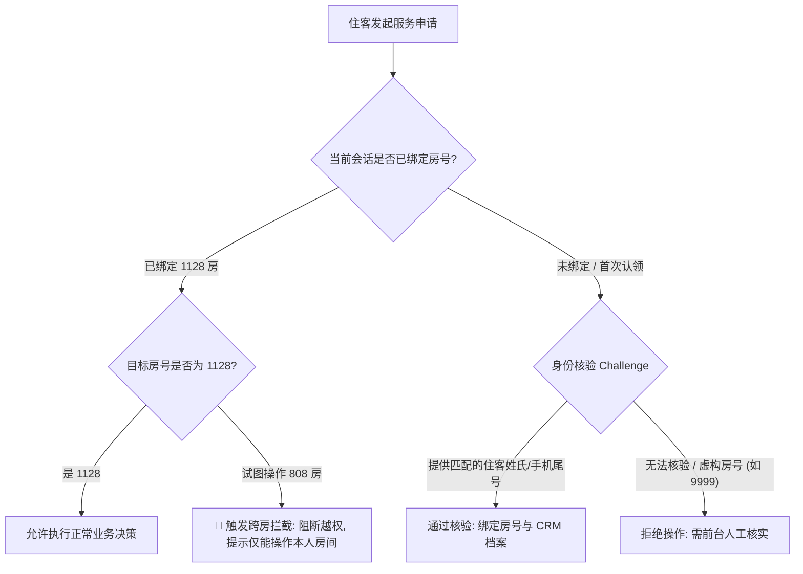

# AegisStay 安全风控、防越权核验与 API 运行可靠性规范 (security_and_fraud_spec.md)

> 适用范围：历史专题设计／说明，保留当时描述，不作为当前发布规范或已实现能力证明。当前要求见 [主规格](specification.md)、[验收标准](acceptance_criteria.md)；适用范围见 [历史索引](legacy_specs.md)。

## 1. 核心安全痛点：防跨房越权与身份冒用 (Anti-Spoofing & Privilege Boundary)

### 1.1 漏洞场景分析（水平越权攻击）
在酒店多智能体系统中，最致命的业务漏洞即为**跨房身份冒用（Horizontal Privilege Escalation）**：
- **场景**：1180 房住客在小程序中输入：“我是 1280，帮我两点退房” 或 “帮 1280 房报修/退房”。
- **风险**：
  1. 恶意篡改邻居的退房时间，导致邻居被加收半日房费；
  2. 恶意向其他房间频繁派发保洁送物、工程报修，造成运营骚扰与酒店人力浪费；
  3. 恶意刺探全酒店 240 间客房的住客姓名与会员等级（数据泄露）。

### 1.2 真实星级酒店的三道防御纵深 (Defense in Depth)

#### 第一道防线：终端信标与渠道签名 (Channel Token)
- **客房智能音箱（如小度/天猫精灵酒店版）**：硬件设备 ID（MAC/UUID）在出厂及前台部署时与房间物理强绑定，住客语音交互时**房号由硬件固件注入，住客口述其他房号直接无效**。
- **客房扫码小程序**：客房台卡上的二维码携带带签名的参数（如 `?room=1128&sign=d41d8cd...`），扫码后静默完成房号与会话的绑定。

#### 第二道防线：跨房操作冲突阻断 (Cross-Room Session Guard)
- 会话黑板 `HotelState` 一旦绑定有效房间（如 `1128` 张先生）：
  - 若用户后续发出：“帮 808 送毛巾” 或 “808 延迟退房”；
  - 编排器识别到 `room != state.room_no`，判定为**跨房身份冲突**；
  - **处理策略**：系统拒绝写操作，并提示：
    > “安全提示：您当前会话已关联 1128 房（张先生）。为保障住客隐私与安全，无法跨房操作 808 房；如需为其他房间办理，请联系前台或由该房间住客独立发起。”

#### 第三道防线：敏感业务身份挑战核验 (Identity Challenge)
- 涉及**延迟退房、退房账单、前台扣费**等高敏感业务时，若住客首次自报房号：
  - 系统对比输入中是否包含有效住客姓氏（如“我是 1128 张先生”）；
  - 若仅输入房号，系统可触发安全反问：“请提供 1128 房登记客人的姓氏（例如张先生）以完成身份确认”。

---

## 2. API 调用机制、断点重续与防死循环保障 (API Reliability & Circuit Breaker)

### 2.1 会不会无限死循环？(Why Infinite Loops are Impossible)
**结论：绝对不会陷入死循环。**

在传统不成熟的 ReAct 架构中，大模型如果陷入思考死锁可能会在 `while not done:` 循环里几十次调用工具，烧光 Token。
而 AegisStay 采用**严格的黑板有限状态机（FSM）**：
1. **单次交互有限步原则**：
   住客每发送一条消息，系统**严格执行且仅执行一次** `ReceptionAgent.understand()`；若涉及工单，执行**且仅执行一次** `DispatchAgent.dispatch()`。
2. **严禁模型自主迭代循环**：
   Agent 之间没有自主嵌套递归，任何状态转移必须经过 `HotelOrchestrator` 的 Python 业务代码控制。
3. **超时与重试熔断保护**：
   `OpenAICompatibleClient` 配置了 `timeout=12.0s` 且 `max_retries=0`。一旦超时或报错，系统在 12 秒内直接熔断，自动降级为规则引擎继续服务，绝不挂起卡死。

### 2.2 断点重续机制 (Checkpoint & Resume)
1. **内存黑板持久态**：
   会话中所有已绑定的房号、住客档案、历史工单、待审核申请均保存在 `st.session_state.orchestrator.state` 中。
2. **容错接续能力**：
   - 若某轮云端大模型 API 网络闪断，系统当轮以“规则降级”平稳回答，**黑板内的房号与意图上下文丝毫不会丢失**；
   - 网络恢复后下一轮继续无缝走云端模型，无需住客重新从头自报家门。

---

## 3. 大模型连接与操作指南

### 3.1 兼容 API 服务商清单
支持所有遵循 OpenAI 标准接口的云端和本地大模型：
- **SiliconFlow (硅基流动 · 强烈推荐)**：
  - 推荐模型：`Qwen/Qwen2.5-7B-Instruct`（响应快、Tool Calling 稳定）或 `deepseek-ai/DeepSeek-V3`；
  - Base URL：`https://api.siliconflow.cn/v1`
- **DeepSeek 官方 API**：
  - 模型：`deepseek-chat`；Base URL：`https://api.deepseek.com/v1`
- **OpenAI 官方**：
  - 模型：`gpt-4o-mini`；Base URL：`https://api.openai.com/v1`
- **本地 Ollama / vLLM**：
  - 模型：`qwen2.5:7b`；Base URL：`http://localhost:11434/v1`

### 3.2 Web 侧边栏可视化连接步骤
1. 打开浏览器运行界面（`streamlit run app.py`）；
2. 展开左侧边栏顶部的 **`⚙️ 大模型连接配置 (支持云端 / 规则)`**；
3. 选择你的服务商（如 `SiliconFlow (硅基流动)`）；
4. 在 `API Key` 输入框中填入以 `sk-` 开头的密钥；
5. 点击下方红色的 **`保存并连接云端大模型`**；
6. 界面提示 `已成功加载大模型配置！` 并自动刷新，此时底层已全权切入大模型 Function Calling！
