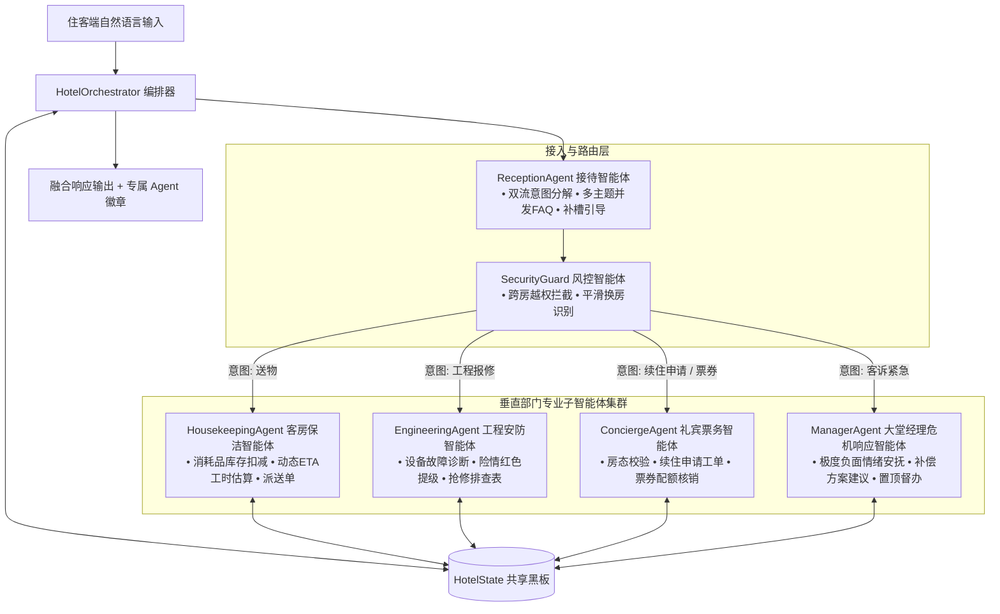

# AegisStay 垂直部门多智能体与会话服务化规格说明书 (specialized_agents_and_session_spec.md)

## 1. 目标与背景 (Objective & Background)

针对当前多智能体协作中“子智能体存在感较弱、派单逻辑较为集中”以及“单客户端多住客并发串流”的业务痛点，本规范定义两大核心拓展模块：
1. **拓展 1：垂直部门专业子智能体集群 (Specialized Domain Sub-Agents)**
   将原单一集中式的 `DispatchAgent` 拆解为具有垂直领域专业知识、内部状态与独立业务动作的专业智能体集群（保洁管家、工程安防、礼宾票务、大堂经理危机响应），在黑板中留下可观测的协同轨迹与专业领域输出。
2. **拓展 2：多会话隔离与服务化中枢 (Multi-Session Isolation & Kiosk Support)**
   构建轻量 API 路由与基于 `session_id` 的状态隔离管理器，彻底解决并发串流问题；同时提供大堂自助智能终端（Kiosk）模式，支持 30 秒超时无操作自动销毁与一键安全复位。

---

## 2. 垂直部门子智能体集群架构 (Domain Sub-Agents Architecture)



### 2.1 各垂直子智能体详细职责与规格

| 智能体角色 (Agent Name) | 专精领域 (Domain Scope) | 内部业务逻辑与状态管理 | 产出与动作 (Action Output) |
| :--- | :--- | :--- | :--- |
| **`HousekeepingAgent`**<br>(客房保洁管家) | `送物`<br>(毛巾/矿泉水/吹风机/牙刷/拖鞋等) | 1. 模拟物料库存盘点（如毛巾、矿泉水剩余库存）；<br>2. **动态 ETA 估算**：根据当前楼层未结工单数动态计算预计送达时间（1单以内：5分钟；2单以上：8-10分钟）；<br>3. 自动生成包含送达时间与物品详情的保洁派送单。 | 生成 `category="送物"` 工单，`assigned_dept="楼层保洁"`，返回个性化保洁管家提示（如：“已通知 11 楼保洁张阿姨，预计 5 分钟送达客房”）。 |
| **`EngineeringAgent`**<br>(工程安防智能体) | `工程报修`<br>(空调/漏水/水管/门锁/断电) | 1. **故障险情等级诊断**：区分一般设备故障（如灯泡不亮、Wi-Fi硬件）与重大险情（漏水、水管爆裂、打不开门、断电）；<br>2. **红色高危预警与自愈提示**：若是重大险情，自动触发 `红色预警`，并将工单优先级强升为 `高`；同时向住客提示安全避险或临时自检指引。 | 生成 `category="工程报修"` 工单，`assigned_dept="工程部"`，输出含安全指引的答复（如：“已为您启动工程紧急响应，老师傅已携带工具包出发”）。 |
| **`ConciergeAgent`**<br>(礼宾接待智能体) | `续住申请` & `票券服务`<br>(续订一天/早餐券派发) | 1. **房态与权益联查**：对接 PMS 核对房间是否在住及全店库存是否充裕；<br>2. **票券配额生成**：若用户索取早餐券/体验券，登记票券核发记录并在 PMS 中增加备注；<br>3. 若申请续住，生成包含续住天数与房态协调标记的工单。 | 生成 `category="续住申请"` 工单，`assigned_dept="前台接待"`，输出续住指引或票券发放确认。 |
| **`ManagerAgent`**<br>(危机响应智能体) | `客诉紧急`<br>(差评/投诉/暴怒情绪) | 1. **情绪降温机制**：检测用户强烈不满，生成包含安抚礼遇（如建议赠送果盘、免单协调）的共情答复；<br>2. **管理层直通车**：跳过普通派单流水，工单直接标记为大堂经理置顶督办件。 | 生成 `category="客诉紧急"` 工单，`assigned_dept="大堂经理"`，优先级锁定为 `高`，`risk_level="红色"`。 |

---

## 3. 多会话隔离与服务化中枢 (Multi-Session Isolation & FastAPI)

### 3.1 架构设计：解决并发串流
在生产和真实面试中，系统必须保证多住客同时在线时的会话独立性：
1. **状态容器隔离**：引入 `SessionManager`，在内存（或 Redis）中以 `session_id` 为 Key 存储独立的 `HotelState` 实例；
2. **住客手机端场景**：微信小程序携带参数 `?room_no=1106&session_id=UUID_XXX`，每次请求携带 `session_id`，不同住客的上下文、待补全状态（pending）和历史消息完全物理隔离；
3. **大堂自助终端 (Kiosk) 场景**：
   - 支持空闲超时重置：前端轮询或后端定时器在 **30 秒无操作** 后自动调用复位接口；
   - 支持一键安全退出：住客办完业务后点击“安全退出”，会话立刻销毁。

### 3.2 核心 RESTful API 接口定义

```text
POST /api/chat
请求体 (Request Body):
{
  "session_id": "guest_1106_sess",
  "message": "我要两瓶矿泉水"
}
响应体 (Response Body):
{
  "session_id": "guest_1106_sess",
  "reply": "赵女士，已为您安排送物，预计 5 分钟送达。",
  "active_agent": "HousekeepingAgent",
  "room_no": "1106",
  "trace": [
    {"agent": "ReceptionAgent", "event": "意图提取", "detail": "送物"},
    {"agent": "HousekeepingAgent", "event": "动态排单", "detail": "楼层保洁 · 动态ETA 5分钟"}
  ],
  "progress_items": [
    {"label": "送物：处理中 · 预计 5 分钟送达", "status": "处理中", "type": "warning"}
  ]
}

POST /api/session/reset
请求体:
{
  "session_id": "guest_1106_sess"
}
响应体:
{
  "status": "success",
  "message": "会话已重置并安全销毁"
}

GET /api/pms/overview
响应体:
{
  "total_rooms": 240,
  "occupied": 156,
  "clean": 48,
  "pending_tickets": 3,
  "department_agents": {
    "HousekeepingAgent": {"name": "客房保洁智能体", "status": "在线", "active_tasks": 1},
    "EngineeringAgent": {"name": "工程安防智能体", "status": "在线", "active_tasks": 0},
    "ConciergeAgent": {"name": "礼宾接待智能体", "status": "在线", "active_tasks": 1},
    "ManagerAgent": {"name": "大堂经理危机响应智能体", "status": "待命", "active_tasks": 0}
  }
}
```

---

## 4. 前端界面可观测性提升 (UI & Observability)

为了在演示和面试答辩中直观展现 Multi-Agent 的协同魅力，前端（Streamlit 或 API 客户端）需做以下视觉升级：
1. **住客端对话框 Agent 动态徽章**：
   - 根据当前的 `active_agent`，显示专属智能体名称和图标：
     - `🧹 客房保洁智能体 · HousekeepingAgent`
     - `🔧 工程安防智能体 · EngineeringAgent`
     - `🛎️ 礼宾接待智能体 · ConciergeAgent`
     - `👔 大堂经理危机响应 · ManagerAgent`
2. **酒店运营中枢：“部门智能体监控大板”**：
   - 在数字房态看板上方增加 **4 个部门智能体的实时负载卡片**，展示其当前处理的工单数与运行状态；
3. **大堂无人终端 (Kiosk) 模拟开关**：
   - 侧边栏增加“开启大堂自助终端模式”开关，显示 30 秒倒计时，支持“退出办理并清空数据”。

---

## 5. 验收标准与测试矩阵 (Acceptance Criteria)

1. **垂直 Agent 派发正确性**：
   - 送物需求必须由 `HousekeepingAgent` 处理，且带有 ETA 估算；
   - 报修故障必须由 `EngineeringAgent` 诊断，险情自动置高优先级；
   - 续住申请必须由 `ConciergeAgent` 处理；
   - 严重客诉必须由 `ManagerAgent` 响应。
2. **会话隔离安全性**：
   - 使用 `session_A` 请求 `1106`，使用 `session_B` 请求 `1128`，两者的消息流、房号绑定和 pending 待办完全互不串联；
   - 调用重置接口后，该 session 的上下文彻底清空。
3. **回归测试全通**：
   - 原有 20 组测试及新测试套件必须全部 PASS。
