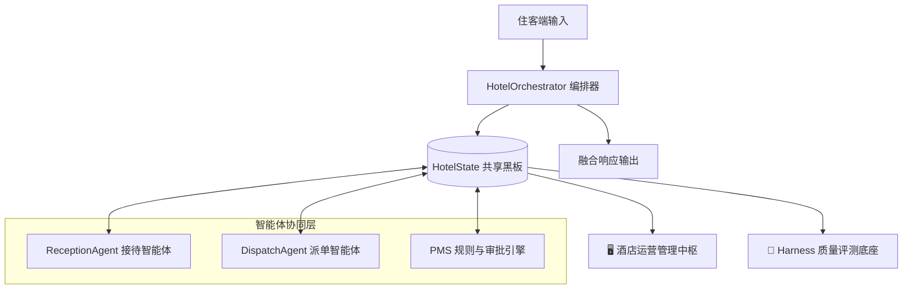
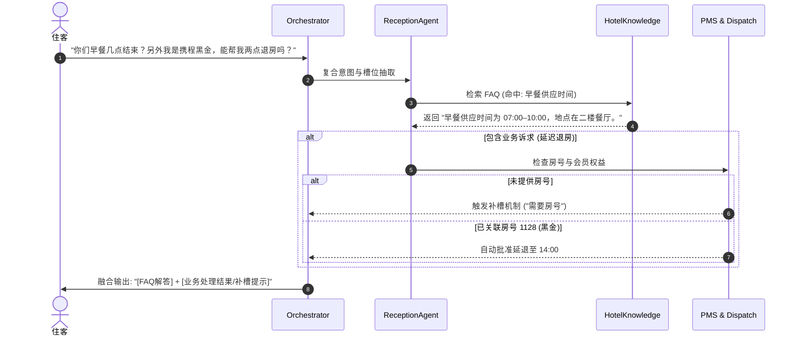

# AegisStay 酒店多智能体系统功能规格说明书 (specification.md)

## 1. 系统机制与架构设计 (System Architecture)

### 1.1 黑板多智能体协同机制 (Blackboard Pattern)
本系统采用经典黑板架构，中央状态 `HotelState` 作为唯一事实来源（Single Source of Truth），所有智能体基于黑板进行信息解耦交互：



### 1.2 智能体角色与职责分工
| 智能体 / 组件 | 核心职责 | 输入 | 输出 / 动作 |
| :--- | :--- | :--- | :--- |
| **ReceptionAgent**<br>（住客接待智能体） | 意图识别、实体槽位提取、知识库检索、多轮追问补槽、复合答复合成 | 用户自然语言 Query、会话历史、知识库配置 | 复合意图解析结果、FAQ 答复内容、槽位补全引导提示词 |
| **DispatchAgent**<br>（工单派单智能体） | 按照行业规则将服务需求派发给对应部门，校验优先级与风险级别 | 房号、服务意图、需求详情、情绪特征 | 结构化工单对象（Ticket）、Function Calling 报文 |
| **PMS Engine**<br>（PMS 规则引擎） | 住客档案匹配、房态与会员权益校验、延迟退房自动化审批、人机协作审批流 | 房号、目标退房时间、PMS 内存数据库 | 审批决议（已批准 / 需前台人工审核）、更新 PMS 退房时间 |
| **Harness Runner**<br>（自动化质检底座） | 离线执行标准用例集，检验意图、槽位、派单合规性与响应耗时 | `eval_dataset.json` 测试用例 | 质检指标报告（准确率、召回率、延迟、PASS/FAIL 详情） |

---

## 2. 复合意图解构机制 (Compound Intent Decomposition)

针对住客单次输入同时包含**信息咨询 (FAQ)** 与 **服务诉求 (Service Action)** 的业务痛点（例如：“你们早餐几点结束？另外我是携程黑金，能帮我两点退房吗？”），系统必须采用**双流解构与响应合成管道**，严禁单选互斥。

### 2.1 意图分类体系
- **只读咨询类 (FAQ Intent)**：`早餐`、`退房政策`、`Wi-Fi`、`健身房`、`泳池`、`淋浴/热水`、`押金`、`发票`、`停车`、`入住时间`。
- **业务操作类 (Service Intent)**：
  - `延迟退房`（需核对会员、房态与退房时间）；
  - `送物`（毛巾、矿泉水、吹风机、枕头、被子、牙刷等）；
  - `工程报修`（空调、水管、灯具、热水等故障）；
  - `客诉紧急`（差评、投诉、噪音、强烈不满）。
- **通用/范围外类 (Chitchat / Out of Domain)**：其他问候、天气或非酒店服务提问。

### 2.2 双流处理流水线 (Dual-Stream Pipeline)


1. **信息流 (Information Stream)**：
   - 提取输入中的 FAQ 关键词，匹配知识库；若命中，生成知识回答片段；
   - 知识回答不受业务槽位缺失的影响，保证先回答住客疑问。
2. **操作流 (Action Stream)**：
   - 提取房号、延迟时间、故障或物品名、情绪等槽位；
   - 若房号缺失，进入待补全队列（`state.pending`）；
   - 若房号已具备，执行权益计算或工单派发。
3. **合成层 (Synthesis Layer)**：
   - 组合结构：`[尊敬的住客/姓名]，[FAQ 回答]。[业务处理结果或补槽指引]`。
   - 示例：“张先生，早餐供应时间为 07:00–10:00，地点在二楼餐厅。另外，您的黑金会员延迟退房至 14:00 申请已获批准，无需额外费用。”

### 2.3 多主题 FAQ 并发匹配与融合机制 (Multi-Topic Matching)
当住客在单轮输入中同时询问多个不同维度的酒店设施或政策时（例如：“健身房几点开始，早餐几点开始，给1106发两张早餐券可以吗”）：
- **全量召回与去重**：`HotelKnowledge.match_all` 遍历知识库，返回所有达到置信度阈值（关键字全词命中或模糊相似度 $\ge 0.72$）的不同主题（Topic）；
- **答复串联拼接**：系统将命中各个 FAQ 的答复自然融合（如：“健身房位于三楼... 早餐供应时间为 07:00–10:00...”）；
- **兼顾服务工单**：若同时包含用品券类需求（如“早餐券”、“拖鞋”），服务流自动创建对应派单，实现“多主题问答 + 实体派单”完全融合输出。

---

## 3. 各项业务判断机制规格 (Decision Rules)

### 3.1 房号与槽位抽取及动态纠错机制
- **房号正则匹配与纠错支持**：
  - 支持形态：`1128`、`1128房`、`1128室`、`房间1128`、`房号:1128`、`Room 1128`。
  - **动态纠错与重绑定支持**：支持口语化更正（如 `搞错了是1128`、`更正是1128`、`换成1128`、`不是9999是1128`），自动重绑定新房号并重新触发未完成的 Pending 业务。
  - 错误明确提示：查询未在住房间（如 9999）时，明确回复“暂未查到 9999 房间的在住档案”，保留延退请求上下文，等待纠正。
- **延迟退房时间提取**：
  - 数字时间格式：`14:00`、`2:00`。
  - 中文口语表达：`两点`、`两点半`、`下午2点`、`14点`。
  - 自动折算规则：若提取小时在 `1 <= hour <= 6` 且未注明“凌晨/上午”，自动转换为下午时间（如 `两点` 识别为 `14:00`）。

### 3.2 延迟退房会员权益与房态审批判定树
```text
输入: room_no, requested_time, profile
  │
  ├── 检查 1: 房间是否在住？
  │     └── 否 ──> 决议: [需前台审核] ("未查到有效在住档案")
  │
  ├── 检查 2: 申请时间是否合法 (必须 > 12:00)？
  │     └── 否 ──> 抛出异常 / 提示时间不符合延退逻辑
  │
  ├── 检查 3: 申请时间是否 <= 14:00？
  │     └── 否 ──> 决议: [需前台审核] ("超出14:00免费权益时限，需审核房费")
  │
  ├── 检查 4: 今日房态是否充裕 (inventory_status == '充裕')？
  │     └── 否 ──> 决议: [需前台审核] ("今日房态紧张，需前台协调")
  │
  └── 检查 5: 会员级别是否为 '携程黑金会员'？
        ├── 是 ──> 决议: [已批准] 自动更新 PMS 退房时间，免费延退
        └── 否 ──> 决议: [需前台审核] ("普通会员权益需前台核实补差")
```

### 3.3 工单生成与多维度风险预警矩阵
| 触发意图 | 示例关键词 | 目标责任部门 | 默认优先级 | 升级条件与风险标记 |
| :--- | :--- | :--- | :--- | :--- |
| **送物** | 毛巾、矿泉水、吹风机、枕头、牙刷 | **楼层保洁** | 低 | 无 |
| **常规工程** | 空调不制冷、灯坏、花洒堵塞 | **工程部** | 中 | 情绪愤怒时升为 **高** |
| **重大安全隐患** | 漏水、没热水、停电、断电、门锁故障、火警 | **工程部** | **高** | 自动触发 **红色高危预警** |
| **客诉紧急** | 投诉、差评、态度差、极度生气、赔偿 | **大堂经理** | **高** | 自动触发 **红色高危预警** |

- **工单字段强校验约束**：
  - `ticket_id`：系统生成唯一定位符（格式 `HT-[A-F0-9]{10}`）；
  - `room_no`：3~4 位数字；
  - `category`：限定在 `["送物", "工程报修", "客诉紧急"]`；
  - `priority`：限定在 `["高", "中", "低"]`；
  - `assigned_dept`：限定在 `["楼层保洁", "工程部", "大堂经理"]`；
  - `status`：初始状态固定为 `处理中`；
  - `risk_level`：凡是 `客诉紧急` 或 `优先级 == 高`（含重大设备险情）均自动标为 `红色`。

### 3.4 情绪识别与高危预警机制
- **触发关键词集**：`投诉`、`客诉`、`差评`、`生气`、`愤怒`、`太差`、`无法忍受`、`赔偿`、`一星`、`垃圾`、`气死`。
- **重大险情关键词集**：`漏水`、`水管爆`、`没热水`、`停电`、`断电`、`门锁`、`打不开门`、`火警`。
- **系统动作**：
  1. `HotelState.sentiment` 立即置为 `"愤怒"` 或关联险情；
  2. 若用户提出重大设备险情，工单类别归为 `工程报修`，优先级升为 `高`，并标记 `红色高危预警`；
  3. 若用户无具体报修/送物诉求仅宣泄不满，直接归入 `客诉紧急` 并路由至 `大堂经理`，运营端卡片呈现红色警戒并置顶。

---

## 4. 人机协同双向通知与审批撤回闭环 (Human-in-the-Loop)

系统充分尊重酒店实际管理流程，不盲目全自动：
1. **延迟退房前台审批与双向会话推送**：
   - 当普通会员或房态紧张延退时，进入“需前台审核”；
   - **双向消息推送**：前台人员点击“批准”或“拒绝”时，系统**自动向住客聊天流追加一条官方推送消息**（如：`【前台通知】您的延迟退房申请已获批准！...`），住客在对话框内即可直接感知审批结果！
2. **审批撤回与防误触重审机制 (Undo / Revocation)**：
   - 若前台人员因误触或房态骤变需变更决议，已批准或已拒绝的申请均提供 **“↩️ 撤回”** 按钮；
   - 点击撤回后，状态重置为 `需前台审核`，自动将 PMS 退房时间回滚至 `12:00`，并向住客推送重新核查通知。
3. **工单结单闭环与醒目视觉色彩**：
   - 运营端与住客端均采用高区分度语义配色：绿色（已批准/已结单）、红色（已拒绝/红色高危）、黄色（待审核/处理中），杜绝色彩混淆。

---

## 5. 具体交付内容清单 (Deliverables)

1. **核心逻辑层 (`hotel_core.py`)**：
   - `HotelState` 数据结构（支持复合意图存储与追踪）；
   - `HotelKnowledge`（多主题并发检索、本地 FAQ 模糊与语义相似度索引）；
   - `ReceptionAgent`（多主题 FAQ 分解、双流槽位解析、平滑换房识别）；
   - `DispatchAgent`（严谨工单生成与 Tool Calling 格式化）；
   - `HotelOrchestrator`（黑板核心业务编排器、PMS 房态持久化操作、跨房越权拦截）；
   - `OpenAICompatibleClient`（支持云端 LLM 与本地规则 100% 幂等降级）。
2. **多端中枢前端 (`app.py`)**：
   - 📱 **住客智能管家端**（模拟住客小程序/对话窗，展示关联房态与实时服务进度条）；
   - 🖥️ **酒店运营中枢**（房态看板、CRM 会员档案、延迟退房待审流、工单流转流水线、结单按钮）；
   - 🧪 **Harness 质检评测台**（支持离线规则极速回归与云端大模型实测质检双模式切换，动态渲染准确率看板）。
3. **自动化评测与用例 (`harness/` & `tests/`)**：
   - `harness/eval_dataset.json`（覆盖单轮、多轮补槽、复合意图、客诉与范围外）；
   - `harness/eval_runner.py`（支持云端大模型实测质检与离线规则回归双引擎）；
   - `tests/test_app.py`（Pytest/Unittest 自动化测试套件，共 18 组严苛用例全绿）。
