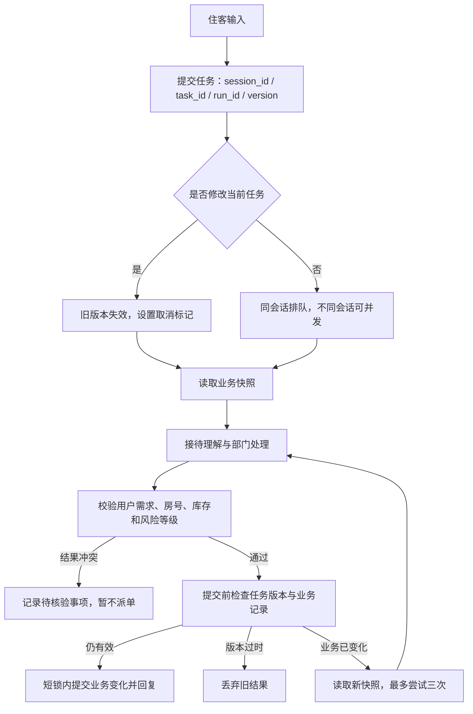

# 异步中断、送物改单与主子 Agent 结果校验

> 适用范围：历史专题设计／说明，保留当时描述，不作为当前发布规范或已实现能力证明。当前要求见 [主规格](specification.md)、[验收标准](acceptance_criteria.md)；适用范围见 [历史索引](legacy_specs.md)。

更新日期：2026-10-20。本文描述已落地的任务控制与业务仲裁功能。本版还补充了 [口语取消](colloquial_delivery_cancellation.md)；最新测试与截图见 [本版验收](release_verification_2026-10-20.md)。

## 1. 实际解决的问题

住客说“1128，送两条毛巾”，旧任务还没完成，又说“不要毛巾了，我要浴巾”。现在系统会把同一任务从 v1 更新到 v2，旧任务即使晚返回，也不能创建毛巾工单、扣减库存或发送过时的成功回复。新需求继承未修改的数量，最终只生成两条浴巾的工单。

这考察异步中断，也考察任务关系识别、版本控制、共享状态一致性、幂等和已执行动作的补偿。单纯停止生成文字，无法撤回一张已经派出的工单。

## 2. 执行结构



实现使用 `ThreadPoolExecutor` 后台线程，不是靠把接口改成 `async def`。处理中的模型请求和部门逻辑运行在快照上，不长时间占用共享业务锁。每次提交前，检查会话实例、当前 run、任务版本、取消标记和业务基线；库存或工单已变更时重新核验，不能用旧快照覆盖新数据。

同一会话中的独立问题按序处理。例如送毛巾时再问早餐时间，不会被误判成撤销送物。明确取消毛巾时，正在处理的独立早餐问题也会保留。默认最多 8 个工作线程，最多接收 128 个未结束任务；容量不足返回 503。

| 标识 | 含义 |
| --- | --- |
| `session_id` | 归属哪个会话；用于路由与隔离，不等于身份认证 |
| `task_id` | 同一业务目标，例如一次送物及其后续变更 |
| `run_id` | 一次具体执行；每次修改会产生新 run |
| `version` | 同一任务的版本；旧版本禁止提交 |
| `request_id` | 客户端重试去重；相同内容重复提交返回原 run，不再扣一次库存 |

`run.status=completed` 只表示本轮计算和本地业务提交完成，不表示物品已经送达。工单另有 `delivery_status`：待派送、配送中、已送达、已取消。`state.tasks` 还记录等待补充、已提交、等待部门确认等业务状态。

## 3. 按实际执行阶段处理取消和更换

| 原任务的阶段 | 当前实现的行为 |
| --- | --- |
| 还在计算，没有提交工单 | 设置取消标记并提高版本；旧结果不能提交；按新需求执行 |
| 已建单、尚未派送 | 修改原工单，释放旧物品预留，再预留新物品；不新增重复工单 |
| 已开始配送 | 保存 `change_request=待部门确认`，明确回复尚未确认撤回；保持原库存账目 |
| 已送达 | 同样等待部门确认；运营端还必须确认已取回原物品，才能按当前系统的退回逻辑释放库存 |
| 无法撤回或更换 | 运营端拒绝变更，保持原单与库存，并通知原会话 |
| 同时有多张送物工单、指代不明 | 询问要修改哪一种，不猜测、不随意取消 |

更换物品库存不足时保留原工单，提示前台协调。新建送物库存不足时不部分扣库存、不确认派送。取消、部门确认和重复提交均有避免重复扣减／返还的处理。

“已取回”是当前系统中的人工确认条件；真实项目还需要考虑卫生物资能否再次入库、回收数量和外部系统回执，不能仅凭一句取消就直接补回可用库存。

线程中的取消是协作式的。已经发出的阻塞模型请求可能继续运行，版本校验保证它不能提交过时结果，不能保证请求立即停止或退回已消耗的 token。Python 官方也说明，已经运行的 Future 不能通过 `cancel()` 强制取消。[Python Future 文档](https://docs.python.org/3/library/concurrent.futures.html#concurrent.futures.Future.cancel)

## 4. 主 Agent 与子 Agent 不一致时听谁的

按字段的责任来源判断，不按“谁是主 Agent”决定真假。

| 判断对象 | 依据 | 发生冲突时 |
| --- | --- | --- |
| 要送什么、数量多少 | 用户最新有效需求；未修改的字段从原目标继承 | 子 Agent 不能把浴巾改成毛巾；无法消歧时追问 |
| 工单是否已经配送 | 当前可信业务记录或部门执行回执 | 主 Agent 不能仅凭自己的旧计划宣称已撤回 |
| 库存能否预留 | 当前库存账本和原子提交检查 | 子 Agent 不能编造库存；库存变化后重新核验 |
| 房号、责任部门、风险等级 | 已绑定任务与确定性业务规则 | 拒绝错房、错部门和险情降级 |
| 最终提交 | 编排器统一提交，并接受上述规则约束 | 证据不足或结果矛盾时记录待人工核验 |

部门先在复制的业务状态上生成结构化提案。校验不仅检查 JSON 形状，也检查物品、数量、库存余额、预留量、借用记录和安全等级。提案不合格时记录 `agent_conflicts`，本次不落单、不扣库存；运营端能看到原因。“标记已核验”仅关闭待核验事项，不会绕过规则自动创建工单。

当前部门角色主要是 Python 业务类，并未分别接入独立的 LLM 自主规划循环。通用的 orchestrator-workers 模式可能由模型动态拆解和委派任务；本项目当前采用受约束的部门路由和业务提交校验，不把两者混称为已完整实现。[Anthropic 官方模式说明](https://www.anthropic.com/engineering/building-effective-agents)

## 5. UI 与接口使用

Streamlit 住客页保持输入框可用，后台处理时可继续输入修改，也可点击“取消当前请求”。住客页与运营页周期读取快照，后台线程不调用 Streamlit API。运营页提供开始派送、确认／拒绝变更、已取回确认和结果冲突核验。

安装项目依赖后，可在项目虚拟环境运行：

```powershell
.\.venv\Scripts\python.exe -m streamlit run app.py
.\.venv\Scripts\python.exe -m uvicorn server:app --host 127.0.0.1 --port 8000
```

两条命令对应两个独立进程，各自使用本地内存，不共享状态。应分别启动在各自终端；本次验收使用 AppTest 与 TestClient，没有启动常驻服务。

| 接口 | 用途 |
| --- | --- |
| `POST /api/chat/submit` | 返回 202 和任务标识，允许继续提交其他消息 |
| `GET /api/tasks/{run_id}?session_id=...` | 查询本会话任务状态；结束后包含 `result` |
| `POST /api/chat` | 兼容原同步调用；后台同样支持并发和版本校验 |
| `GET /api/session/{session_id}` | 查看当前会话消息、工单、任务和冲突 |
| `POST /api/tickets/{ticket_id}/dispatch` | 模拟运营端确认开始派送 |
| `POST /api/tickets/{ticket_id}/change/confirm` | `{"approved":true,"returned":false}` 确认撤回与变更；拒绝使用 `approved=false` |

异步提交请求示例：

```json
{
  "session_id": "guest-session",
  "request_id": "delivery-1",
  "message": "1128 给我送两条毛巾",
  "force_rules": true
}
```

随后以新的 `request_id` 提交“我不要毛巾了，我要浴巾”，客户端以新 run 为当前目标。重复发送同一请求时保持相同 `request_id`；换了内容还复用旧 ID 会返回 409。查询其他会话的 run 返回 404；这只是归属检查，真实部署仍需认证、授权和租户边界。

## 6. 验收与实现边界

2026-10-16 离线验收覆盖原核心、API、已有演进模块、任务竞争以及 Streamlit 交互；详细命令与输出保存在 [验收记录](task_interruption_verification.md)。新增竞争测试用线程事件／屏障控制时序，实际让旧任务晚返回、让两个住客读取同一库存，再核对最终状态，未用固定长 sleep 代替并发。

```powershell
$env:AEGIS_FORCE_RULES='1'
.\.venv\Scripts\python.exe -m unittest tests/test_app.py
.\.venv\Scripts\python.exe -m unittest discover -s tests -p 'test_*.py'
.\.venv\Scripts\python.exe -m harness.eval_runner
```

本次仅验证本地规则和模拟业务链路，没有调用付费模型，没有重测历史 QPS、云端准确率或 token 节约比例。

- 状态、消息和任务保存在单进程内存中；没有新增 Redis、MySQL、跨日持久记忆或进程重启恢复。
- 锁和库存提交只在一个 `SessionManager` 进程内生效；多进程部署需要外部持久状态、事务／原子操作和消息队列。
- 工单为本地模拟；若接真实 PMS，不能先在工作线程调用不可撤销外部操作再丢弃本地快照。需要幂等命令、受版本约束的提交、执行回执和补偿流程。
- 目前对明确送物更换、取消和简单数量继承做确定性解析；多物品同时请求会要求分开确认，复杂语言理解仍需扩展评测。
- 动态 few-shot 与这些执行机制分属不同层面。本次没有训练模型或实现自动微调，也没有把既有演进模块中的固定提升字段当成真实实验结果。

## 7. 代码入口

- [任务运行时](../agent_runtime.py)：后台执行、同会话队列、版本检查、快照提交和部门变更确认。
- [提案契约与送物解析](../agent_protocol.py)：更换／取消解析和主子结果字段校验。
- [业务核心](../hotel_core.py)：部门提案、工单更换、库存与借用记录校验。
- [前端](../app.py) 与 [API](../server.py)：可继续输入的聊天、运营确认与提交／查询接口。
- [竞争测试](../tests/test_task_runtime.py)、[API 测试](../tests/test_api.py)、[交互测试](../tests/test_streamlit.py)。
